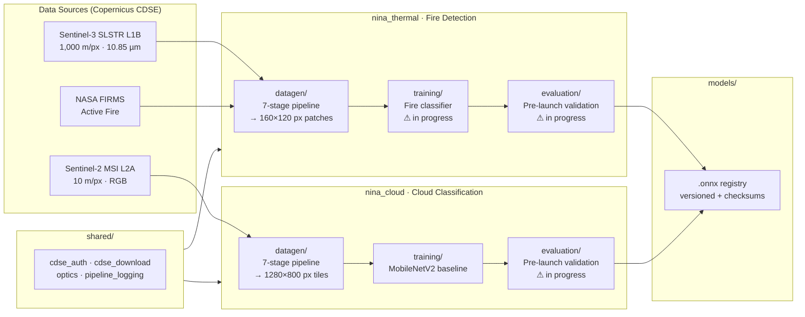

# WaskiriSat — AI Payload Development

> **Bolivia's first CubeSat** — autonomous wildfire detection and image quality control from a 525 km LEO orbit.

[](https://python.org)
[](LICENSE)
[](nina_thermal/datagen/tests/)
[](https://en.wikipedia.org/wiki/Sun-synchronous_orbit)
[](https://www.ucb.edu.bo)

---

## Mission

Bolivia loses millions of hectares to fire every year in the Chiquitanía and Beni regions — with no sovereign space-based monitoring capability. **WaskiriSat** changes that.

This repository is the AI/ML workspace for WaskiriSat's two onboard payloads: physics-based training dataset generation, model development, and the pre-launch model registry. All work is pre-flight — the pipelines produce synthetic proxy datasets by downscaling calibrated satellite imagery to match the exact sensor characteristics of the hardware flying onboard.

---

## Payloads

| | Payload | Sensor | Resolution | Task |
|---|---------|--------|-----------|------|
| 🔥 | **NINA** — Neural Infrared Anomaly Observer | FLIR Lepton 3.5 | 160×120 px · 3,563 m/px GSD | Wildfire hotspot detection |
| ☁️ | **IQC** — Image Quality Control | PAG7936 RGB | 1280×800 px · 562.5 m/px GSD | Cloud classification for downlink prioritisation |

---

## Tech Stack

**Language & ML**

[](https://python.org)
[](https://pytorch.org)
[](https://numpy.org)
[](https://opencv.org)

**Earth Observation & Geospatial**

[](https://dataspace.copernicus.eu)
[](https://sentinels.copernicus.eu/web/sentinel/missions/sentinel-3)
[](https://sentinels.copernicus.eu/web/sentinel/missions/sentinel-2)
[](https://firms.modaps.eosdis.nasa.gov)
[](https://rasterio.readthedocs.io)
[](https://geopandas.org)

**Quality**

[](https://pytest.org)
[](https://black.readthedocs.io)

---

## Architecture



---

## Repository Layout

```
waskirisat-pl-aidev/
├── nina_thermal/               # Bounded context: fire detection (NINA payload)
│   ├── datagen/                # 7-stage SLSTR → synthetic Lepton patch pipeline
│   ├── training/               # Fire classifier training  [WIP]
│   ├── evaluation/             # Pre-launch validation suite  [WIP]
│   ├── docs/                   # Scientific rationale & architecture spec
│   └── resources/              # Bolivia ROI GeoJSON files
├── nina_cloud/                 # Bounded context: cloud classification (IQC payload)
│   ├── datagen/                # Parallel Sentinel-2 → PAG7936 tile pipeline
│   ├── training/               # MobileNetV2 baseline
│   └── evaluation/             # Pre-launch validation suite  [WIP]
├── shared/                     # Cross-context utilities
│   ├── cdse_auth.py            # Copernicus OAuth2
│   ├── cdse_download.py        # Scene acquisition
│   ├── optics.py               # PSF blur (shared by both sensors)
│   └── pipeline_logging.py     # Structured run logging
├── models/                     # Artifact registry (.onnx + checksums)
├── data/                       # Pipeline outputs — gitignored (~72 GB)
├── requirements.txt
└── .env.template               # CDSE credentials template
```

---

## Quickstart

```bash
git clone <repo-url>
cd waskirisat-pl-aidev
python -m venv venv && source venv/bin/activate
pip install -r requirements.txt
cp .env.template .env           # add CDSE_USER and CDSE_PASSWORD
```

> **Copernicus credentials** are free at [dataspace.copernicus.eu](https://dataspace.copernicus.eu).

---

## Running the Pipelines

Both pipelines follow the same 7-stage sequence. Run each stage from the repo root.

### NINA Thermal — Fire Detection Dataset

```bash
# Stage 1 — Download Sentinel-3 SLSTR granules from CDSE
python -m nina_thermal.datagen.pipelines.run_acquisition \
    --roi nina_thermal/resources/bo_nina_roi_simplified.geojson \
    --start 20230601 --end 20230930 \
    --output_dir data/01_raw

# Stage 2 — Extract brightness temperature channels to .npy
python -m nina_thermal.datagen.pipelines.run_extraction \
    --input_dir data/01_raw --output_dir data/02_extracted

# Stage 3 — Aggregate to Lepton GSD, tile into 160×120 patches
python -m nina_thermal.datagen.pipelines.run_processing \
    --input_dir data/02_extracted --output_dir data/03_patches \
    --roi nina_thermal/resources/bo_nina_roi_simplified.geojson \
    --firms_dir data/firms

# Stage 4 — Simulate FLIR Lepton 3.5 sensor degradation
python -m nina_thermal.datagen.pipelines.run_simulation \
    --input_dir data/03_patches --output_dir data/04_dataset

# Stage 5 — Assign granule-level train/val/test splits
python -m nina_thermal.datagen.pipelines.run_split \
    --dataset_dir data/04_dataset

# Stage 6 — Balance fire/no-fire classes (target: 20% fire)
python -m nina_thermal.datagen.pipelines.run_balance \
    --dataset_dir data/04_dataset

# Stage 7 — Generate dataset_summary.json
python -m nina_thermal.datagen.pipelines.run_report \
    --dataset_dir data/04_dataset
```

### NINA Cloud — Cloud Classification Dataset

```bash
python -m nina_cloud.datagen.pipelines.run_acquisition  --roi nina_thermal/resources/bo_nina_roi_simplified.geojson --start 20230601 --end 20230930 --output_dir data/cloud/01_raw
python -m nina_cloud.datagen.pipelines.run_extraction   --input_dir data/cloud/01_raw   --output_dir data/cloud/02_extracted
python -m nina_cloud.datagen.pipelines.run_processing   --input_dir data/cloud/02_extracted --output_dir data/cloud/03_tiles
python -m nina_cloud.datagen.pipelines.run_simulation   --input_dir data/cloud/03_tiles  --output_dir data/cloud/04_dataset
python -m nina_cloud.datagen.pipelines.run_split        --dataset_dir data/cloud/04_dataset
python -m nina_cloud.datagen.pipelines.run_balance      --dataset_dir data/cloud/04_dataset
python -m nina_cloud.datagen.pipelines.run_report       --dataset_dir data/cloud/04_dataset
```

---

## Tests

```bash
pytest                                   # all 148 tests
pytest nina_thermal/datagen/tests/ -v    # thermal pipeline only
pytest nina_cloud/datagen/tests/ -v      # cloud pipeline only
```

---

## How to Contribute

This is a pre-launch project — **physical correctness is non-negotiable**. Every processing decision is traceable to a sensor datasheet or radiometric reference. Before contributing, read [`nina_thermal/docs/CLAUDE_CODE_BRIEF.md`](nina_thermal/docs/CLAUDE_CODE_BRIEF.md) to understand the constraints.

### Open contribution areas

| Area | Location | Status |
|------|----------|--------|
| 🔥 **Thermal fire classifier** | `nina_thermal/training/` | Empty — needs to be built |
| ☁️ **Cloud classifier improvements** | `nina_cloud/training/` | MobileNetV2 baseline exists |
| 📊 **Pre-launch evaluation suite** | `nina_thermal/evaluation/` `nina_cloud/evaluation/` | Empty — needs design |
| 🔬 **Datagen improvements** | `nina_thermal/datagen/` `nina_cloud/datagen/` | Noise models, spectral corrections, labeling |

### Steps

1. Fork the repository
2. Create a feature branch: `git checkout -b feat/your-feature`
3. Write tests alongside your code — the pipelines have 148 tests as a baseline
4. Open a pull request with a description of the physical justification for any parameter changes

---

## Affiliation

**Universidad Católica Boliviana "San Pablo"** · [BIRDS Program](https://birds-project.com) · **Kyushu Institute of Technology**

WaskiriSat contributes Bolivia's first space-based Earth observation capability for wildfire monitoring — open data, open models, open source.
