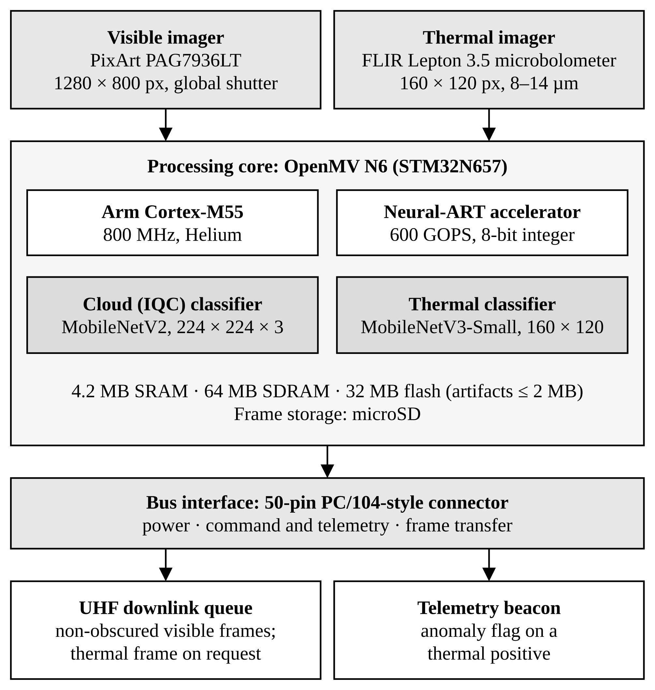
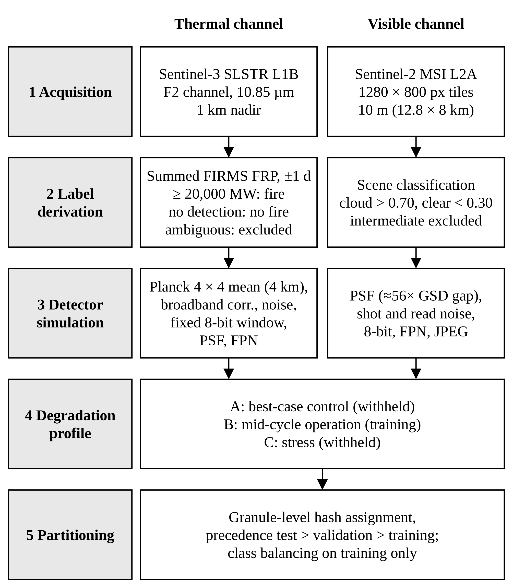
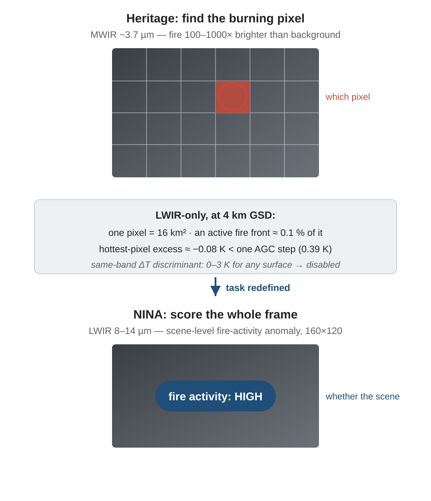
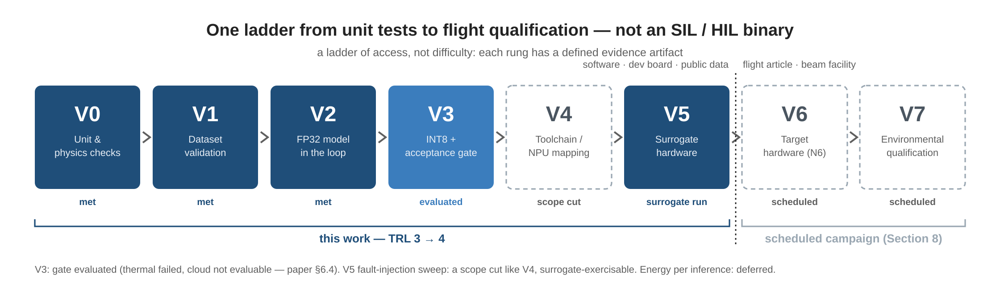
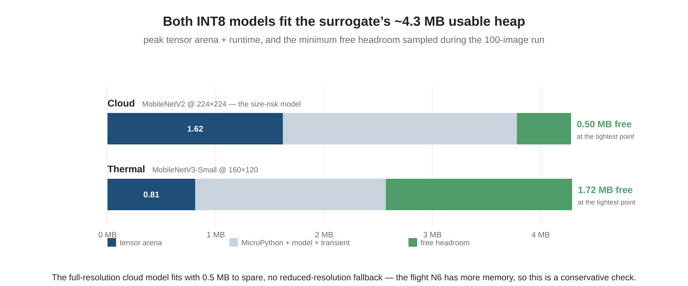
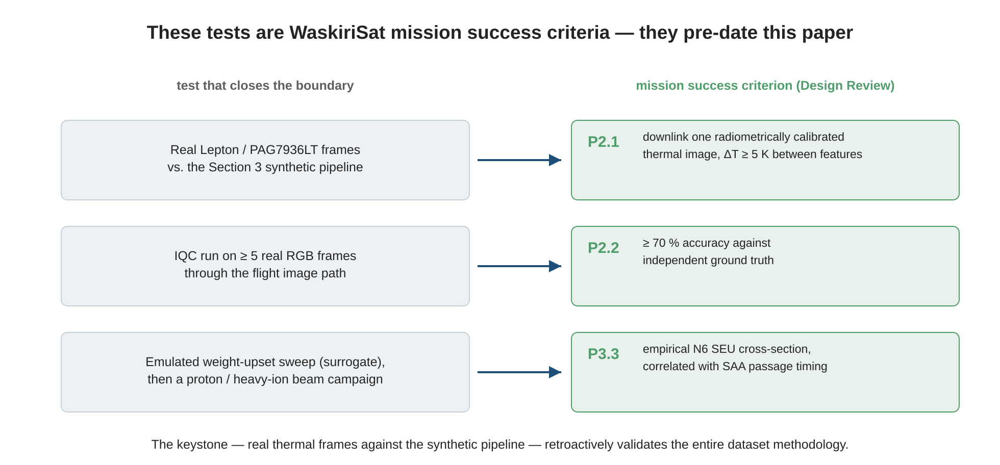
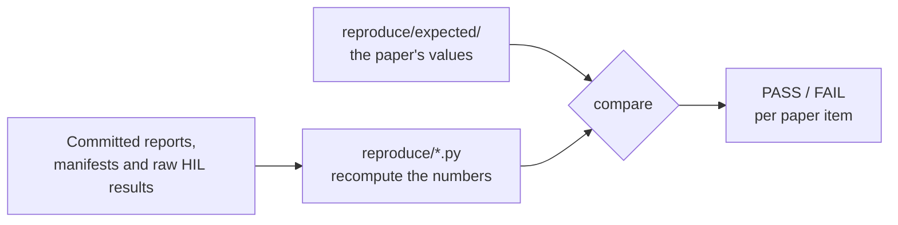

<div align="center">

# WaskiriSat · NINA and IQC payloads

**Models, data pipelines and reproducibility record for the IAC-26 paper**

*Onboard edge AI for wildfire monitoring using visible and LWIR imagery on Bolivia's first nanosatellite*

[](https://doi.org/10.5281/zenodo.23647727)
[](https://github.com/WaskiriSat-AI-EO/waskirisat-pl-aidev/releases/latest)
[](https://github.com/WaskiriSat-AI-EO/waskirisat-pl-aidev/actions/workflows/ci.yml)
[](LICENSE)

[Paper record](https://dl.iafastro.directory/event/IAC-2026/paper/111635/) ·
[Reproduce](#reproduce-the-paper) ·
[Limitations](docs/limitations.md) ·
[Cite](#cite)

</div>

> **Status: frozen at the paper.** This repository is the reproducibility record of release [`iac26-v1.0.1`](https://github.com/WaskiriSat-AI-EO/waskirisat-pl-aidev/releases/tag/iac26-v1.0.1) (Zenodo DOI [10.5281/zenodo.23647728](https://doi.org/10.5281/zenodo.23647728)). Later development (newer thermal models, the flight gate, more hardware-in-the-loop work) continues in other repositories of the organization.

---

## What this is

WaskiriSat is Bolivia's first university-developed CubeSat (525 km sun-synchronous orbit). Its AI payload runs two small classifiers on a commercial microcontroller, so that the satellite sends down only what is worth the bandwidth:

> **Status: frozen at the paper.** This repository is dedicated to the IAC-26 paper and is kept as the reproducibility record of release [`iac26-v1.0.1`](https://github.com/WaskiriSat-AI-EO/waskirisat-pl-aidev/releases/tag/iac26-v1.0.1) (Zenodo DOI above). Later development (newer thermal models, the flight gate, further hardware-in-the-loop work) continues in other repositories of the organization. Known gaps of this record are listed in [`docs/limitations.md`](docs/limitations.md) and [`CHANGELOG.md`](CHANGELOG.md).

| Payload | Sensor | Input | Task | Code |
|---|---|---|---|---|
| **NINA** (thermal) | FLIR Lepton 3.5, 8–14 µm | 160 × 120 | Flag scenes with high fire activity | [`nina_thermal/`](nina_thermal/) |
| **IQC** (visible) | PixArt PAG7936LT RGB | 1280 × 800 | Discard cloudy tiles before downlink | [`nina_cloud/`](nina_cloud/) |

The flight board was not available at submission, so **everything here is pre-flight**: the datasets are synthetic proxies, built by degrading calibrated Sentinel-2 / Sentinel-3 and NASA FIRMS products to the flight sensors' characteristics. The paper's contribution is the **method** for making such claims honestly: every number carries an evidence tier (T1–T4) and sits on a rung of a verification ladder (V0–V7).

<p align="center">
  <br>
  <sub><b>Payload architecture.</b> Two imagers, one processing core with two INT8 classifiers, one bus connector.</sub>
</p>

## At a glance

| | |
|---|---|
| **6 of 6** reproduction checks pass | `make reproduce`: Tables 5, 6, 7, 8, §4 thresholds, §6.6 summary (what was delivered; see the table below for what was not) |
| **0.976 – 0.980** cloud ROC-AUC (INT8) | across degradation profiles A, B, C on 1,408 test tiles each |
| **0.787** thermal ROC-AUC (FP32) | 90% CI 0.644–0.943; **read the [limitations](docs/limitations.md) before citing it** |
| **1.94 MB / 1.45 MB** INT8 models | cloud / thermal, both fit the surrogate board's usable heap |
| **3 of 4** thermal gate criteria **fail** | the thermal INT8 is published as the HIL-tested file, **not released for flight** |
| **117,840** packets, **0** integrity errors | OBC-driven hardware-in-the-loop run (paper §6.6) |

## How the data is made

Both channels follow the same five stages, from a public calibrated product to a split dataset. Profile B is used for training; A and C are held out as best-case and stress conditions.

<p align="center">
  <br>
  <sub><b>Dataset synthesis.</b> Rebuild commands are at the end of this page.</sub>
</p>

### Why the thermal task is scene-level

At about 4 km per pixel, one pixel covers 16 km² and an active fire front is about 0.1% of it: the hottest-pixel excess (about −0.08 K) is smaller than one 8-bit AGC step (0.39 K). Locating the burning pixel is not possible, so NINA scores the whole frame for fire activity instead.

<p align="center">
  <br>
  <sub><b>From "which pixel" to "whether the scene".</b> Schematic, not real imagery.</sub>
</p>

## How far the evidence reaches

Two schemes, defined in [`docs/evidence-and-ladder.md`](docs/evidence-and-ladder.md): **tiers** say how traceable a number is (T1 measured by a third party … T4 deferred), and a **ladder** says how much of the system a test exercised. The paper claims V0–V5 and specifies V6–V7.

<p align="center">
  <br>
  <sub><b>Verification ladder.</b> V0–V5 are covered by this work (TRL 3 → 4); V6–V7 are a scheduled campaign.</sub>
</p>

## Results

### Test performance (evidence tier T2: host evaluation on synthetic data)

| Model | Profile | Recall | Precision | ROC-AUC | PR-AUC |
|---|---|---:|---:|---:|---:|
| **Cloud** INT8 | A | 0.671 | 1.000 | 0.976 | 0.972 |
| | **B** (trained) | **0.861** | **0.978** | **0.980** | **0.977** |
| | C | 0.577 | 0.994 | 0.977 | 0.970 |
| **Thermal** FP32 | B | 0.778 | 0.651 | 0.787 | 0.702 |
| **Thermal** INT8 | B | 0.972 | 0.547 | 0.694 | 0.539 |

Thresholds are fixed on validation (recall ≥ 0.95): cloud INT8 **0.934**, thermal FP32 **0.456** and INT8 **0.2875**. Recall depends strongly on the profile, so profile B is the training condition and not an on-orbit estimate. Reproduce with `make table5 table6 parity`.

### Execution on the surrogate board (tier T1: real silicon, not the flight chip)

| | Mean latency | Tensor arena | Min. free heap | Model |
|---|---:|---:|---:|---:|
| **Cloud** (MobileNetV2, 224 × 224) | 1,747 ms | 1.62 MB | 0.50 MB | 1.94 MB |
| **Thermal** (MobileNetV3-Small, 160 × 120) | 670 ms | 0.81 MB | 1.72 MB | 1.45 MB |

100 images each, zero errors. The surrogate has strictly less compute than the flight N6, so latency and memory are upper bounds on the target. Energy was not measured. Reproduce with `make table7`.

<p align="center">
  <br>
  <sub><b>Memory fit.</b> The full-resolution cloud model fits with 0.5 MB to spare and needs no reduced-resolution fallback.</sub>
</p>

## What is not claimed

Read [`docs/limitations.md`](docs/limitations.md) before reusing any number. The short version:

- **Synthetic data only.** The degradation multipliers are assumptions, and no real flight-sensor imagery has been used.
- **The thermal INT8 fails its acceptance gate** (3 of 4 criteria) and is not released for flight.
- **The thermal labels have a known flaw.** June 2023 has no FIRMS data, and those scenes supply all test negatives, so the model may partly separate seasons rather than fire.
- **On-device preprocessing of the cloud model differs from training** (RGB565 plus resize).
- **The board is a surrogate**, and fault injection was not exercised.

The remaining tests are specified, with acceptance criteria, in [`docs/deferred-protocols/`](docs/deferred-protocols/). Three of them are already mission success criteria, which predate this paper:

<p align="center">
  <br>
  <sub><b>Deferred tests and the mission criteria they close.</b></sub>
</p>

---

## Reproduce the paper

Everything below needs **no GPU and no data download**: the tables are recomputed from the reports, manifests and raw hardware results committed here.

```bash
git clone https://github.com/WaskiriSat-AI-EO/waskirisat-pl-aidev.git
cd waskirisat-pl-aidev
python3.13 -m venv .venv && source .venv/bin/activate   # fish: source .venv/bin/activate.fish
pip install -r requirements.txt --extra-index-url https://download.pytorch.org/whl/cpu
make reproduce      # recompute every paper item and compare it with the paper
```



| Paper item | Command | Status |
|---|---|---|
| Tables 5, 6 and §4 thresholds | `make table5 table6 parity` | Reproduces. The thermal INT8 threshold is 0.2875 ([`ERRATA.md`](ERRATA.md) #2) |
| Table 7 | `make table7` | Reproduces |
| Table 8, §6.6 | `make table8 test2-summary` | Reproduces what was delivered; row 3 (97/100) and the paper's 199/200 need raw logs that were not delivered |
| Figures 1, 2 | `make figures` | Reproduces (SVG) |
| Table 2 | `make table2` | Not implemented; the profile values are in each payload's `datagen/config.py` |
| Binary integrity | `make verify-models` | Cloud files OK; the thermal INT8 comes from the release assets |

The exact command and status of every table and figure is in [`reproduce/paper_map.md`](reproduce/paper_map.md); discrepancies between sources are in [`ERRATA.md`](ERRATA.md).

### Models and data

| Artifact | Where |
|---|---|
| INT8 and FP32 models | [Release assets](https://github.com/WaskiriSat-AI-EO/waskirisat-pl-aidev/releases/tag/iac26-v1.0). [`models/MANIFEST.json`](models/MANIFEST.json) holds each sha256; `make verify-models` checks them. The cloud files are also tracked in git under `nina_cloud_results/` |
| Cloud dataset | Provisional OneDrive link in [`nina_cloud/DATASET_CARD.md`](nina_cloud/DATASET_CARD.md); an open archive is pending |
| Thermal dataset | Not published yet; its manifests and split registry are in [`data/manifests/`](data/manifests/) |
| Model and dataset cards | [`nina_cloud/`](nina_cloud/) and [`nina_thermal/`](nina_thermal/): `MODEL_CARD.md`, `DATASET_CARD.md`, `configs/paper.yaml` |

## Repository map

```
nina_thermal/     NINA fire classifier: datagen → training → quantization → evaluation   (owner: Osvaldo)
nina_cloud/       IQC cloud classifier: datagen → training → quantization → evaluation   (owner: Leyla)
nina_cloud_results/  Cloud training, quantization and evaluation results as delivered
hil/              Surrogate hardware-in-the-loop (OpenMV H7 Plus + ESP32 OBC): code and raw results (owner: Misael)
models/           MANIFEST.json with the sha256 of every binary; reports of the published models
reproduce/        One script per paper table or figure, compared with the paper's values
shared/           Utilities used by both payloads (CDSE access, optics, seeding, logging)
data/manifests/   Versioned dataset manifests and split registries (the data itself is not in git)
docs/             Evidence taxonomy, limitations, deferred campaign, card templates, figures
ERRATA.md         Discrepancies between sources and which value prevails
CHANGELOG.md      What each release contains and leaves out
```

<details>
<summary><b>Rebuild the datasets</b> (needs free Copernicus credentials)</summary>

<br>

Both pipelines run the same seven stages from the repo root. Copernicus credentials are free at [dataspace.copernicus.eu](https://dataspace.copernicus.eu); copy `.env.template` to `.env` and fill in `CDSE_USER` / `CDSE_PASSWORD`.

**NINA thermal** (Sentinel-3 SLSTR + FIRMS → Lepton 3.5 patches)

```bash
python -m nina_thermal.datagen.pipelines.run_acquisition --roi nina_thermal/resources/bo_nina_roi_simplified.geojson --start 20230601 --end 20230930 --output_dir data/01_raw
python -m nina_thermal.datagen.pipelines.run_extraction  --input_dir data/01_raw --output_dir data/02_extracted
python -m nina_thermal.datagen.pipelines.run_processing  --input_dir data/02_extracted --output_dir data/03_patches --roi nina_thermal/resources/bo_nina_roi_simplified.geojson --firms_dir data/firms
python -m nina_thermal.datagen.pipelines.run_simulation  --input_dir data/03_patches --output_dir data/04_dataset
python -m nina_thermal.datagen.pipelines.run_split       --dataset_dir data/04_dataset
python -m nina_thermal.datagen.pipelines.run_balance     --dataset_dir data/04_dataset
python -m nina_thermal.datagen.pipelines.run_report      --dataset_dir data/04_dataset
```

**IQC cloud** (Sentinel-2 → PAG7936 tiles)

```bash
python -m nina_cloud.datagen.pipelines.run_acquisition --roi nina_thermal/resources/bo_nina_roi_simplified.geojson --start 20230601 --end 20230930 --output_dir data/cloud/01_raw
python -m nina_cloud.datagen.pipelines.run_extraction  --input_dir data/cloud/01_raw --output_dir data/cloud/02_extracted
python -m nina_cloud.datagen.pipelines.run_processing  --input_dir data/cloud/02_extracted --output_dir data/cloud/03_tiles
python -m nina_cloud.datagen.pipelines.run_simulation  --input_dir data/cloud/03_tiles --output_dir data/cloud/04_dataset
python -m nina_cloud.datagen.pipelines.run_split       --dataset_dir data/cloud/04_dataset
python -m nina_cloud.datagen.pipelines.run_balance     --dataset_dir data/cloud/04_dataset
python -m nina_cloud.datagen.pipelines.run_report      --dataset_dir data/cloud/04_dataset
```

Training, quantization and evaluation entry points are documented per payload in [`nina_thermal/README.md`](nina_thermal/README.md) and [`nina_cloud/README.md`](nina_cloud/README.md). The delivered cloud paper model came from the Keras scripts in `nina_cloud_results/`, not from the PyTorch pipeline in `nina_cloud/` ([`ERRATA.md`](ERRATA.md) #1).

**Incremental, multi-operator acquisition (cloud).** Split assignment is deterministic and permanent: each scene is hashed to `train` / `val` / `test` the first time it is registered, and the mapping lives in the scene registry. Re-running or adding scenes never moves a scene between splits. Profile B is simulated for train and val scenes; test scenes get A, B and C. Balancing (50/50 cloud:clear) applies to the train split only. To share the registry between operators, commit it as `data/manifests/scene_registry.json` and pass `--registry data/manifests/scene_registry.json` to the acquisition, split and simulation stages. Always `git pull` before acquiring so already-registered scenes are skipped, set `NINA_OPERATOR` to record provenance, and commit the updated registry afterwards.

</details>

<details>
<summary><b>Hardware-in-the-loop (V5)</b></summary>

<br>

[`hil/`](hil/) contains the OpenMV H7 Plus payload code, the ESP32 stand-in OBC firmware and the raw results of Test 1 (surrogate execution) and Test 2 (OBC-driven integration). The code is kept exactly as it ran. See [`hil/README.md`](hil/README.md) and [`hil/ENVIRONMENT.md`](hil/ENVIRONMENT.md).

</details>

## Cite

Cite the archived version through [`CITATION.cff`](CITATION.cff) (GitHub's "Cite this repository" button reads it):

- Paper: [IAF Digital Library, IAC-2026 paper 111635](https://dl.iafastro.directory/event/IAC-2026/paper/111635/). The manuscript PDF there is access-restricted.
- This repository, all versions: [10.5281/zenodo.23647727](https://doi.org/10.5281/zenodo.23647727). Exact version for the paper: [10.5281/zenodo.23647728](https://doi.org/10.5281/zenodo.23647728) (`iac26-v1.0.1`).

## Contributing, license and affiliation

The repository is frozen at the paper, so changes are limited to corrections of the record; open an issue and see [`CONTRIBUTING.md`](CONTRIBUTING.md). Open items are listed in [#33](https://github.com/WaskiriSat-AI-EO/waskirisat-pl-aidev/issues/33).

Code is BSD 3-Clause ([`LICENSE`](LICENSE)). Proposed licence for model weights and derived datasets: CC BY 4.0, with the Copernicus and NASA FIRMS attribution given in the model and dataset cards.

Universidad Católica Boliviana "San Pablo".
