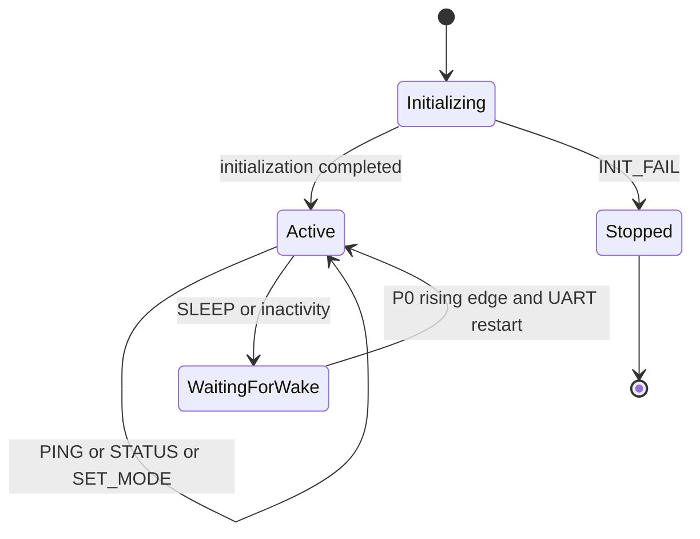
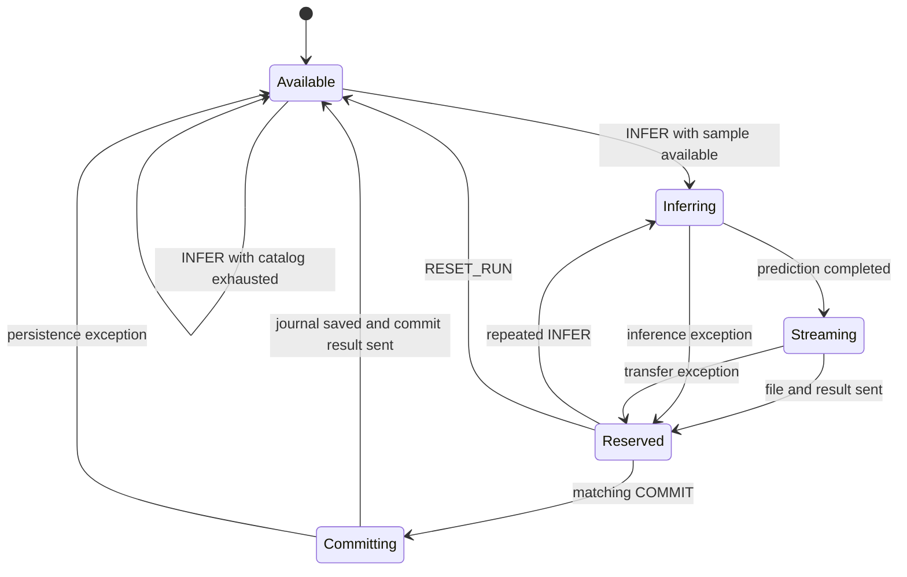

# HIL protocol — ESP32 OBC and OpenMV payload integration

Technical deployment and wire-protocol reference for the surrogate hardware-in-the-loop experiments supporting the WaskiriSat paper. **Test Surrogate** characterizes standalone model execution; **Test Payload** adds mode selection, source-image transport, and persistent sample progress. This is a pre-flight laboratory experiment using stored images, not live flight sensors.

| Item | Implementation / evidence |
|---|---|
| Payload controller | [`main_code.py`](../openmv/test2_payload/main_code.py), application v3.1 |
| Payload configuration | [`config.py`](../openmv/test2_payload/config.py) |
| Framing and CRC | [`payload_protocol.py`](../openmv/test2_payload/payload_protocol.py), wire protocol v2 |
| Inference and journal | [`model_runner.py`](../openmv/test2_payload/model_runner.py), schema v3.1 |
| Stand-in OBC | [`obc_v3.ino`](../obc_esp32/obc_v3.ino), application v3.2 |
| Embedded baseline | [`model_execution.py`](../openmv/test1_surrogate/model_execution.py), schema v6.3 |
| Reports | [Test Surrogate](../results/test1/documentation.md), [Test Payload](../results/test2/documentation.md) |
| Environment / samples | [`ENVIRONMENT.md`](../ENVIRONMENT.md), [`manifest.csv`](../catalogue/manifest.csv) |

Application, JSON schema and wire versions are independent: application v3.1 does not imply wire protocol v3.1. This reference describes the implementation in `hil/`.

## Hardware and connections

| Element | Role and requirement |
|---|---|
| OpenMV Cam H7 Plus | STM32H743 surrogate payload, board identifier `OPENMV4P`, OpenMV firmware 5.0.0 |
| ESP32-32X | OBC surrogate; UART2 on GPIO16/17 and wake output on GPIO4 |
| OpenMV SD card | 8 GB; stores both models, 200 labeled PNGs, Test Surrogate outputs and Test Payload progress journals |
| Host computer | OpenMV IDE, Arduino build/upload, USB serial capture and offline verification |
| Two USB data connections | Separate host connections for board power, deployment and logs |
| Signal connections | Crossed UART, wake line and common ground |

No FLIR Lepton or PAG7936 camera is accessed by these scripts. No ESP32 SD card or flash log is used. The runtime reads images from OpenMV storage.

Connect signals with power removed, then power boards through their normal USB inputs. Use 3.3 V logic; do not apply 5 V to UART or wake inputs. The wiring does not require tying the boards' supply rails together.

| ESP32 endpoint | OpenMV H7 Plus endpoint | Direction | Function |
|---|---|---|---|
| GPIO16 / UART2 RX | P4 / UART3 TX | OpenMV → ESP32 | Frames, images, results and acknowledgments |
| GPIO17 / UART2 TX | P5 / UART3 RX | ESP32 → OpenMV | Framed commands |
| GPIO4 | P0, input with pull-down | ESP32 → OpenMV | Rising-edge wake request |
| GND | GND | Common | Required with separate USB power too |

Payload UART is **460800 baud, 8N1**. Hardware flow control is disabled; P1/RTS and P2/CTS are unused. ESP32 USB logging is a separate interface at **115200 baud**. The sketch is an autonomous scheduler: typing text in the USB serial monitor does not transmit framed payload commands.

## Required files and storage

| Test | Source directory | Results directory |
|---|---|---|
| Test Surrogate | [`openmv/test1_surrogate/`](../openmv/test1_surrogate/) | [`results/test1/`](../results/test1/) |
| Test Payload | [`openmv/test2_payload/`](../openmv/test2_payload/) and [`obc_esp32/`](../obc_esp32/) | [`results/test2/`](../results/test2/) |

The experiment names follow the source directories: **Test Surrogate** (`test1_surrogate/`) and **Test Payload** (`test2_payload/`). Result directories retain their existing `test1/` and `test2/` names.

### OpenMV application

Copy the contents of [`openmv/test2_payload/`](../openmv/test2_payload/) together into an importable directory on the OpenMV filesystem, normally its exposed root. Keep one active copy of each module to avoid importing stale configuration.

```text
<OpenMV import root>/
├── config.py
├── payload_protocol.py
├── model_runner.py
└── main_code.py
```

The validated procedure runs `main_code.py` manually from OpenMV IDE. Do not rename it `main.py` for that procedure. After reset, the operator must launch it again; it does not automatically restart.

### OpenMV SD card

```text
/sdcard/paper_tests/
├── models/
│   ├── cloud_detection.tflite
│   └── fire_detection.tflite
├── cloud_detection/
│   ├── clear/       # 50 PNGs, class 0
│   └── cloud/       # 50 PNGs, class 1
├── fire_detection/
│   ├── no_fire/     # 50 PNGs, class 0
│   └── fire/        # 50 PNGs, class 1
├── test_1/          # generated Test Surrogate outputs
│   ├── cloud_detection_results.json
│   └── fire_detection_results.json
└── test_2/          # generated persistent progress
    ├── mission_state_v3_a.json
    └── mission_state_v3_b.json
```

Outputs and journals are not prerequisites for a first run. Both applications search `/sdcard/paper_tests`, `/sd/paper_tests`, `/paper_tests`, then `paper_tests`. Keep one populated root.

Use the dataset identities in [`catalogue/manifest.csv`](../catalogue/manifest.csv) to prepare the same image folders for both tests. The paths in the manifest are relative to `paper_tests/`.

Test Surrogate uses the standalone [`model_execution.py`](../openmv/test1_surrogate/model_execution.py) with this data tree; it does not need the four Test Payload modules. The executable entry point is `model_execution.py`.

### ESP32 and host

Use a matching Arduino sketch directory:

```text
<local sketch directory>/
└── obc_v3/
    └── obc_v3.ino
```

Copy [`obc_esp32/obc_v3.ino`](../obc_esp32/obc_v3.ino) into that layout. No Python, images or models are deployed to ESP32. The sketch uses `Arduino.h` and ESP32-core `HardwareSerial`, without ArduinoJson or an SD library.

Capture the complete ESP32 USB stream with a serial terminal supporting file logging. The result format is illustrated by [`Results_Test2.txt`](../results/test2/Results_Test2.txt).

## Arduino and OpenMV setup

### ESP32 / Arduino

1. Use Arduino IDE **2.3.10** and install the **esp32 by Espressif Systems** board package through Boards Manager. The package reference and configuration are recorded in [`ENVIRONMENT.md`](../ENVIRONMENT.md).
2. Open `obc_v3/obc_v3.ino`. Select **ESP32 Development Kit** for the ESP32-32X and its USB port. Verify the UART2 RX/TX assignments to GPIO16/17 and the wake output on GPIO4 against the wiring table.
3. Keep CPU, flash and partition options at the selected board target defaults, without manual overrides. Upload speed is independent of both runtime baud rates.
4. Verify pin constants, compile and upload. New core versions require compilation and hardware verification; compatibility is not established by this document.
5. Close any serial monitor holding the port. Open a file-capture terminal at 115200 baud before resetting the ESP32. Opening a port may itself reset the board; retain its boot messages.
6. Start/reset the OBC only after OpenMV is running and capture is active. The sketch starts autonomously; there is no start menu. Its boot message identifies `ESP32 OBC v3.2`.

### OpenMV

1. Use the **OpenMV Cam H7 Plus** with **OpenMV firmware 5.0.0**. The embedded runtime identified in the Test Surrogate report is MicroPython 1.28.0-49. Use **OpenMV IDE 5.0.0** for deployment, as recorded in [`ENVIRONMENT.md`](../ENVIRONMENT.md).
2. Prepare the SD layout and application modules. Runtime imports include `pyb`, `image`, `ml`, `ulab.numpy`, `ujson`, and `ustruct`; use the board runtime, not desktop substitutes.
3. Verify models on the host by size and SHA-256, including copies on the mounted card. Preserve deployment names, particularly `fire_detection.tflite`.
4. Keep the committed laboratory settings:

   ```python
   UART_ID = 3
   UART_BAUD = 460800
   UART_RX_BUFFER_BYTES = 4096
   UART_HARDWARE_FLOW_CONTROL = False
   WAKE_PIN_NAME = "P0"
   LOW_POWER_ENABLED = False
   TRANSFER_SOURCE_FILE = True
   PERSIST_PROGRESS = True
   ```

5. Run `main_code.py` from OpenMV IDE before starting the OBC. After an OpenMV reset, manually launch it again.
6. Preserve journals for continuation; reset them only for an intentionally independent acquisition after archiving existing evidence.

Do not hash full models immediately before `ml.Model()` on OpenMV. Test Surrogate documented heap fragmentation and tensor-allocation failure from that sequence. Hash on the host, or use a separate preflight followed by board restart. On-device size and tensor-contract checks remain enabled.

### Models and inference contracts

| Property | RGB_CLOUD | THERMAL_FIRE |
|---|---|---|
| File | `cloud_detection.tflite` | `fire_detection.tflite` |
| Bytes | 1,941,072 | 1,452,472 |
| Reported arena, bytes | 1,622,736 | 807,504 |
| Source | 1280 × 800 RGB PNG | 160 × 120 grayscale PNG |
| Input | int8 NHWC `(1,224,224,3)` | float32 NCHW `(1,3,120,160)` |
| Input scale / zero point | 1.0 / −128 | 1.0 / 0 |
| Output | int8 scalar `(1,1)` | int8 scalar `(1,1)` |
| Output scale / zero point | 0.00390625 / −128 | 0.04537102 / −5 |
| Interpretation | Cloud probability | Logit followed by sigmoid |
| Decision | Positive if probability ≥ 0.5 | Positive if probability ≥ 0.5 |

Cloud SHA-256: `f528086c23c0e997b906fea87eb02ceec6e2a1d59a596fa6e71c0a6493946d5e`.
Fire SHA-256: `6e486fc771f9c7a984d281208980692e1c31340241984f2ff487db5ada1201e8`.
Deploy the thermal artifact as `fire_detection.tflite` and preserve the file identities above, which are also recorded in the [Test Surrogate report](../results/test1/documentation.md).

Cloud uses RGB565, explicit bilinear resizing to 224 × 224 and int8 input written to the model buffer. Fire normalizes grayscale to [0,1] and copies it into three float32 channel planes. Thus Fire has a float32 input despite its INT8 artifact designation. OpenMV returns dequantized output; only Fire requires sigmoid. A mode change releases the current model; the next inference loads the selected model. Consecutive samples in one mode reuse it.

## Operating modes and session lifecycle

`RGB_CLOUD` visits `clear` then `cloud`; `THERMAL_FIRE` visits `no_fire` then `fire`. Filenames are lexicographically sorted within each class. Each mode has an independent zero-based position. Sample IDs use:

```text
<MODE>:<six-digit index>:<filename>
THERMAL_FIRE:000099:val_49_fire_frp48119.png
```

Test Surrogate record indices are one-based; join results by dataset and filename. Keep names, class folders and image contents fixed during continuation. The Test Payload journal is not bound to image-content hashes and cannot independently validate a changed dataset.

The payload accepts commands immediately at cold start. The OBC scheduler:

1. Flushes stale input, drives wake high for 80 ms then low, and waits for READY.
2. Sends PING and measures ACK round-trip time.
3. Sends `SET_MODE:<name>` and consumes its status result and DONE.
4. Processes up to five `INFER` / `COMMIT` transactions in that mode.
5. Sends SLEEP and selects the next non-exhausted mode after a 3000 ms loop delay.
6. Marks the mode exhausted when INFER returns `no_more_images=true`.
7. Emits `MISSION_COMPLETED` and a final summary after both modes are exhausted.

Each pass is attempted up to three times, with delays of 500, 1000 and 2000 ms after failures. `MODE_PASS_RETRIES_EXHAUSTED` does not permanently halt the scheduler: a later loop can retry that mode. The 3000 ms interval is an inter-loop delay, not a fixed sample cadence.

OpenMV emits READY every 1000 ms in the active session loop. SLEEP or 60000 ms of inactivity ends that session. With `LOW_POWER_ENABLED=False`, LEDs turn off and the payload polls its wake flag every 10 ms, without `pyb.stop()`. After P0 wake it delays 75 ms, reinitializes UART and clears stale input. Deep-stop exists behind `LOW_POWER_ENABLED=True` but was not validated in the stable experiment. Green indicates session idle, blue inference/transfer and red an error; transient errors may return to green after reporting.

### Payload state diagrams

The application has two related state machines: the session lifecycle and the reserved-sample transaction. Separating them keeps wake and sleep transitions distinct from inference and commit transitions. The diagrams describe `main_code.py` and `model_runner.py` with `LOW_POWER_ENABLED=False`.

#### Session lifecycle



`Active` receives commands and emits periodic READY frames. `WaitingForWake` turns LEDs off and polls the wake flag. A rising edge on P0 is followed by a 75 ms delay and UART reinitialization. It does not enter deep-stop. Sample reservation and persistent positions survive session sleep.

#### Sample transaction within an active session



`Available` means no sample is reserved. INFER reserves the catalog entry before model execution. `Reserved` means that entry awaits commit, including after an inference or transfer exception. Such exceptions produce ERROR and DONE. Repeated INFER reuses the reservation. A mismatched COMMIT or a request to switch to another mode leaves the reservation unchanged; the latter produces `SAMPLE_PENDING_COMMIT`.

With an exhausted catalog, INFER returns `no_more_images=true` and DONE without creating a reservation. RESET_RUN clears both positions and any reservation and unloads the model. With source transfer disabled, successful inference proceeds directly to Reserved after RESULT and DONE.

The COMMIT handler advances the RAM position and clears the reservation before saving the journal. Successful persistence produces `committed=true`. A persistence exception produces COMMIT_FAIL without rolling RAM state back, as represented by the transition to Available. The diagrams show application states, not additional software modules.

## Wire protocol v2

### Frame layout

A frame is a 20-byte header followed by exactly `payload_length` bytes. Multibyte integers are unsigned and **little-endian**. There is no terminator, byte escaping, JSON frame envelope, or per-chunk acknowledgment.

| Offset | Bytes | Field | Meaning |
|---:|---:|---|---|
| 0 | 2 | magic | ASCII `OM`, hex `4F 4D` |
| 2 | 1 | version | `0x02` |
| 3 | 1 | type | Message code below |
| 4 | 2 | sequence | Command correlation number |
| 6 | 2 | flags | Zero normally; zero-based index for FILE_CHUNK |
| 8 | 4 | payload_length | Length excluding header |
| 12 | 4 | payload_crc32 | CRC32 of payload only |
| 16 | 4 | header_crc32 | CRC32 of header bytes 0–15 |
| 20 | variable | payload | Text, JSON, binary or empty |

OpenMV uses `<2sBBHHIII`; the CRC-protected prefix is `<2sBBHHII`. ESP32 sequences range from 1 to 65535 and wrap while skipping zero. READY and unsolicited diagnostics use zero. Responses carry their command's sequence; COMMIT uses a new sequence from INFER. ESP32 accepts asynchronous READY/DEBUG and counts other sequence mismatches.

Receivers scan for `OM`, check header CRC, version and length, read payload, then check payload CRC. Maximum frame payload is 16384 bytes. OpenMV additionally limits decoded commands to 256 characters; actual commands/sample IDs are ASCII. A failed read is discarded and a later read scans for magic again. Resynchronization is implemented, but arbitrary-corruption recovery was not experimentally characterized.

### CRC32

CRC uses the reflected CRC-32/ISO-HDLC polynomial `0xEDB88320` with standard initial/final XOR. OpenMV uses `binascii.crc32`; ESP32 implements the matching update. The incremental accumulator starts at zero and carries between chunks. ASCII `123456789` yields `0xCBF43926`; empty input yields zero. Frame CRCs are little-endian uint32; JSON reports decimal integers.

Header CRC covers the first 16 bytes, including length and payload CRC. Payload CRC covers each body. Whole-file CRC covers concatenated source bytes, excluding all headers. CRC detects accidental corruption; it provides neither authentication nor encryption.

### Worked hexadecimal command frame

This example is generated by the committed `encode_header()` implementation for command `INFER`, sequence 1, flags 0. It is a reproducible encoding example, not a byte capture from the experimental UART log. The payload is the five UTF-8/ASCII bytes `49 4E 46 45 52`; no newline or NUL is appended.

```text
Offset  Header / payload bytes
00      4F 4D 02 10 01 00 00 00 05 00 00 00 C1 98 76 94
10      9E 1A 00 4F 49 4E 46 45 52
```

Offsets in this display are hexadecimal; offset `10` is decimal 16. The complete frame is **25 bytes**: 20 header bytes plus five command bytes.

| Byte offsets (decimal) | Encoded bytes | Decoded meaning |
|---|---|---|
| 0–1 | `4F 4D` | Magic `OM` |
| 2 | `02` | Wire protocol v2 |
| 3 | `10` | COMMAND message |
| 4–5 | `01 00` | Sequence 1 |
| 6–7 | `00 00` | Flags 0 |
| 8–11 | `05 00 00 00` | Payload length 5 |
| 12–15 | `C1 98 76 94` | Payload CRC32 `0x947698C1` |
| 16–19 | `9E 1A 00 4F` | Header-prefix CRC32 `0x4F001A9E` |
| 20–24 | `49 4E 46 45 52` | `INFER` |

The payload CRC covers only `INFER`. The header CRC covers the first 16 bytes, including the encoded payload CRC, but excludes its own field. Changing sequence, flags, type, length or payload CRC requires recomputing the header CRC.

The calculation can be checked on the host with Python's standard library:

```python
import binascii
import struct

payload = b"INFER"
payload_crc = binascii.crc32(payload) & 0xFFFFFFFF
prefix = struct.pack("<2sBBHHII", b"OM", 2, 0x10, 1, 0, len(payload), payload_crc)
header_crc = binascii.crc32(prefix) & 0xFFFFFFFF
frame = prefix + struct.pack("<I", header_crc) + payload

assert payload_crc == 0x947698C1
assert header_crc == 0x4F001A9E
assert len(frame) == 25
assert frame == bytes.fromhex(
    "4F 4D 02 10 01 00 00 00 05 00 00 00 C1 98 76 94 "
    "9E 1A 00 4F 49 4E 46 45 52"
)
print(frame.hex(" ").upper())
```

For this command the payload replies with an ACK using sequence 1, followed by the inference/file response sequence described below. Selecting sequence 1 here is illustrative; the autonomous scheduler allocates sequences across all its commands, including PING and SET_MODE.

### Messages

| Code | Name | Payload |
|---|---|---|
| `0x01` | READY | JSON firmware/wire versions, available/active modes, free memory |
| `0x02` | ACK | Command base, e.g. `SET_MODE`; receipt, not execution success |
| `0x04` | RESULT | JSON status, inference, commit or exhaustion result |
| `0x05` | ERROR | Text code and optional colon-separated detail |
| `0x06` | DONE | Empty response terminator where applicable |
| `0x07` | DEBUG | Diagnostic text |
| `0x10` | COMMAND | UTF-8 command text |
| `0x20` | FILE_BEGIN | JSON sample_id, name, mime_type, size_bytes, chunk_bytes, kind |
| `0x21` | FILE_CHUNK | Raw source bytes, normally 512; last chunk can be shorter |
| `0x22` | FILE_END | JSON sample_id, bytes, chunks, crc32, openmv_uart_tx_us |

### Commands and response semantics

| Command | Successful response | Effect |
|---|---|---|
| `PING` | ACK only | Link responsiveness; no RESULT or DONE |
| `STATUS` | ACK → RESULT → DONE | Mode, progress, reservation, generation, memory/counters |
| `SET_MODE:RGB_CLOUD` | ACK → RESULT → DONE | Select Cloud; release previous model if changed |
| `SET_MODE:THERMAL_FIRE` | ACK → RESULT → DONE | Select Fire; release previous model if changed |
| `INFER` | ACK → optional file → RESULT → DONE | Reserve and infer without advancing |
| `COMMIT:<sample_id>` | ACK → RESULT → DONE | Advance/save progress if accepted; inspect `committed` |
| `RESET_RUN` | ACK → RESULT → DONE | Reset both positions/reservation, save reset, unload model |
| `SLEEP` | ACK → DONE | End session; no RESULT |

ACK precedes execution and may be followed by ERROR. Command exceptions normally yield ERROR and DONE. Decode/length errors yield ERROR and DONE before ACK; a non-COMMAND input yields EXPECTED_COMMAND without the usual sequence. A custom host must account for these cases; PING and SLEEP cannot use a generic reader requiring RESULT.

### Inference and source-file transaction

```text
ESP32                                      OpenMV
  |---- COMMAND(seq=N, INFER) ---------------->|
  |<--- ACK(seq=N, INFER) ---------------------|
  |                  reserve → load/reuse → infer
  |<--- FILE_BEGIN(seq=N, JSON) ---------------|
  |<--- FILE_CHUNK(seq=N, flags=0, bytes) ------|
  |<--- FILE_CHUNK(seq=N, flags=1, bytes) ------|
  |<--- ... ----------------------------------|
  |<--- FILE_END(seq=N, JSON CRC/size) ---------|
  |<--- RESULT(seq=N, inference JSON) ---------|
  |<--- DONE(seq=N) ---------------------------|
  |     validate result and streamed file      |
  |---- COMMAND(seq=M, COMMIT:<sample_id>) ---->|
  |<--- ACK(seq=M) ----------------------------|
  |                       advance → save journal
  |<--- RESULT(committed=true) / DONE ---------|
  |     print telemetry → update RAM aggregates|
```

The original source image is sent after inference and before RESULT; no input tensor, resized image or model is transferred. OpenMV limits it to 8 MiB. The OBC checks zero-based chunk order using `flags`, computes incremental CRC and discards chunk bytes. At FILE_END, received size and CRC are compared to `bytes` and `crc32`. FILE_BEGIN metadata is descriptive; the current OBC does not independently enforce all metadata fields or the footer's chunk count.

The nominal sender emits the complete sequence. The receiver success predicate is DONE received, RESULT received and `fileValid`; it does not explicitly require `fileSeen` or a FILE_END marker. The observed successful transfers therefore do not prove rejection of every missing-frame sequence. No per-chunk ACK or selective retransmission exists; recovery occurs at a later command/pass attempt. `TRANSFER_SOURCE_FILE=False` skips file frames and changes the measurement configuration.

## Persistent progress and acquisition continuity

INFER reserves the current catalog entry and repeated INFER requests reuse it until commit. A switch to another mode with an outstanding reservation raises `SAMPLE_PENDING_COMMIT`. A matching COMMIT advances the next-position counter and saves state; a mismatching reservation returns `committed=false`.

Without an active reservation, a recognized mode/index below its current position is accepted as already committed. This supports duplicate acknowledgment but does not revalidate arbitrary historical filenames or retain results. Sequence numbers are transport identifiers, not persistent sample identities.

Two journal slots hold `schema_version`, `generation`, and per-mode `positions`. Saving writes and flushes a temporary file, removes the target slot selected by generation parity, renames the temporary file, and attempts `os.sync()`. Startup chooses the readable slot with the highest generation and a positions dictionary. The other slot offers an older fallback. There is no journal checksum or dataset-content binding, and power-fail atomicity was not characterized. If neither slot is readable, initialization retains zero positions.

OpenMV checkpoints survive restart; ESP32 aggregates are RAM-only. A commit occurs before combined telemetry is printed. A reset in that interval can leave persistent advancement without its printed record. This is checkpoint continuation, not an atomic transaction spanning payload storage, OBC RAM and host disk.

### Acquisition progress and restart

The results obtained in [Test Payload](../results/test2/Results_Test2.txt) correspond to starting checkpoints of Cloud 11 and Fire 4. The controller committed the remaining 89 Cloud and 96 Fire samples, exhausted both 100-image catalogs and emitted `MISSION_COMPLETED`. All 185 recorded predictions matched the Test Surrogate embedded baseline. Link counters, timing and classification aggregates describe this observation interval.

Preserve the journals and unchanged dataset to continue from a checkpoint. For a new independent acquisition, archive previous results, stop the ESP32 scheduler and `main_code.py`, then reset both mode counters from OpenMV IDE using the deployed modules:

```python
import model_runner
model_runner.initialize()
model_runner.reset_progress()
print(model_runner.status())  # active mode position must be 0
```

Restart the payload, begin host capture, then start/reset ESP32. RESET_RUN provides the corresponding framed-command operation; typing it into the ESP32 USB terminal does not execute it. Preserve final progress journals with the results of each acquisition.

## Timeouts and failure reporting

| Setting | Value | Meaning |
|---|---:|---|
| OpenMV UART timeout / character timeout | 1000 / 100 ms | Driver settings |
| OpenMV session frame read | 200 ms | Polling; idle magic timeout is normal |
| OpenMV / ESP32 RX buffer | 4096 / 32768 bytes | UART input buffering |
| READY wait | 8000 ms, up to three pulses | Wake synchronization |
| ACK wait | 3000 ms | Command receipt deadline |
| ESP32 frame read | 5000 ms | Frame reception timeout |
| Transaction no-progress | 120000 ms | No valid frames; not a total transaction deadline |
| Samples per pass | 5 | Maximum before sleep/rotation |
| Session idle / READY repeat | 60000 / 1000 ms | Payload lifecycle |

Exact reads reset timeouts on byte progress. The OBC transaction timer refreshes for valid frames before sequence filtering, so unrelated valid traffic can extend the wait. Neither write-all loop imposes a bounded application retry deadline. These settings do not establish hard real-time guarantees.

| Fault / error | Meaning and diagnostic action |
|---|---|
| `HEADER_CRC`, `PAYLOAD_CRC` | Corruption; inspect crossed wiring, ground, baud and counters |
| `VERSION` / `PROTOCOL_VERSION` | Wire mismatch; use compatible firmware endpoints |
| `PAYLOAD_TOO_LARGE` / `FRAME_LENGTH` | Frame length exceeds limit; inspect stream alignment |
| `MAGIC_TIMEOUT`, `RX_TIMEOUT` | Missing prefix or incomplete read; distinguish idle from mid-frame loss |
| `READY_TIMEOUT` | Payload absent, asleep or not running; inspect P0 and manual launch |
| `ACK_TIMEOUT` | No matching ACK; inspect link/sequence and payload execution |
| `CHUNK_ORDER`, `FILE_FINAL_CHECK` | Chunk order or file size/CRC failure; retain raw log |
| `TRANSACTION_INCOMPLETE` | RESULT/DONE not obtained; inspect remote error and timing |
| `FRAME_MALLOC` | ESP32 allocation failure; inspect heap and received length |
| `COMMAND_ENCODING`, `COMMAND_TOO_LONG`, `UNKNOWN_COMMAND` | Invalid command text/length |
| `EXPECTED_COMMAND` | Non-COMMAND frame sent to payload command receiver |
| `INIT_FAIL` | Initialization exception; inspect imports, SD root and class directories |
| `<COMMAND>_FAIL` | Handler exception; retain accompanying detail |
| `PAPER_TESTS_ROOT_NOT_FOUND`, `MISSING_CLASS_DIR` | Missing or incorrectly nested data |
| `UNKNOWN_MODE`, `SAMPLE_PENDING_COMMIT`, `RESERVATION_MODE_MISMATCH` | Mode/reservation state conflict |
| `MISSING_SAMPLE_ID`, `COMMIT_REJECTED` | OBC cannot identify or accept commit outcome |
| `SESSION_FAIL` | Exception outside individual command handling |

OBC domains include `UART_INTEGRITY`, `UART_TIMEOUT`, `ESP32_MEMORY`, `ESP32_UART`, `ESP32_STATE`, and `OPENMV_REMOTE`. Preserve both fault text and counters: not every fault has a dedicated counter, and last-fault fields are not a complete history. Implemented checks are not measured fault-detection coverage; the stable run did not systematically inject faults.

## Telemetry and results

Telemetry is implemented by `appendTelemetry()` in [`obc_v3.ino`](../obc_esp32/obc_v3.ino) and recorded in [`Results_Test2.txt`](../results/test2/Results_Test2.txt). USB output combines human-readable lines with JSON records identified by `record_type`:

| Record | Contents |
|---|---|
| `event` | Uptime, severity, source, event/detail, free heap and link counters |
| `telemetry` | `obc` transaction, commit, file-integrity and fault fields; `openmv` inference result |
| `summary` | Mission completion, cumulative link counters and per-mode aggregates |

The OBC reports wake-to-ready time, PING RTT, transaction time, received bytes/CRC, `file_valid` and `committed`. The OpenMV result contains sample identity, expected/predicted class, probability, computation/memory metrics and file-transfer information. Source bytes are discarded after CRC validation rather than retained by the ESP32.

OpenMV `*_us` fields use microseconds; OBC `*_ms` fields use milliseconds. `transaction_ms` covers INFER and its response, excluding the subsequent COMMIT. `transaction_before_result_us` includes inference and source streaming before RESULT. Link byte counts include framing/control overhead. These quantities should be distinguished from pure inference latency.

The [Test Surrogate report](../results/test1/documentation.md) documents standalone model measurements; the [Test Payload report](../results/test2/documentation.md) documents OBC-controlled integration. Their result paths are `results/test1/` and `results/test2/`, respectively.

## Acceptance criteria

Review the following conditions for the nominal configuration (`LOW_POWER_ENABLED=False`, source transfer and persistence enabled):

| Level | Acceptance condition |
|---|---|
| Sample identity | Mode, dataset, filename and sample ID agree with the catalog; count each logical sample once |
| Transaction | Inference result received, `obc.file_valid=true`, `obc.committed=true`, and no sample fault |
| Baseline consistency | Match Test Payload to Test Surrogate by dataset and filename; predicted class and estimated quantized output agree, probability difference below `1e-6` |
| Progress | Accepted counts equal catalog size minus the recorded starting checkpoint; both catalogs reach exhaustion |
| Completion | `MISSION_COMPLETED` and final `mission_completed=true`; telemetry counts agree with per-mode summary aggregates |
| Link integrity | No recorded header/payload CRC, length, timeout or sequence-mismatch errors during the nominal interval |

The results obtained satisfy the recorded interval counts of 89 Cloud and 96 Fire, with 185 baseline matches and zero recorded link errors. Baseline agreement measures deployment consistency; classification accuracy remains a separate model metric. Nominal results do not establish deep-stop behavior or fault-injection coverage.
