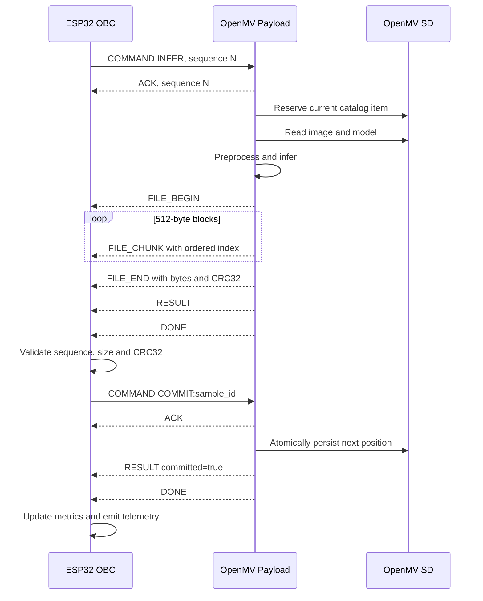

# Technical Report and Firmware Documentation

## Fault-Tolerant UART Coordination Between an ESP32 OBC and an OpenMV H7 Plus for Embedded Cloud and Fire Detection

**Experiment:** Test 2 — OBC–Payload Integration  
**Date:** 5 September 2026  
**ESP32 firmware:** OBC v3.2, terminal-only storage policy  
**OpenMV firmware:** Payload v3.1, result schema v3.1  
**Wire protocol:** UART protocol v2  
**OpenMV runtime:** OpenMV 5.0.0  
**Reference evaluation:** Phase-1 result schema v6.3  

---

## Abstract

This report documents the implementation and experimental validation of a two-board embedded inference system in which an ESP32 acts as an on-board computer (OBC) and an OpenMV Cam H7 Plus acts as the image-processing payload. The OBC selects an operating mode, wakes and synchronizes the payload, requests inference, receives the source image and inference metadata through a framed UART protocol, validates the transfer using per-frame and whole-file CRC32 checks, and commits the sample only after the transaction has been verified. The OpenMV executes two previously validated TensorFlow Lite models: an RGB cloud-detection model and a thermal fire-detection model.

The final stable execution processed the 185 samples that remained after earlier interrupted trials: 89 Cloud samples and 96 Fire samples. It transferred 59,307,552 source-image bytes and ended with 117,840 received frames, zero header CRC errors, zero payload CRC errors, zero length errors, zero sequence mismatches, zero timeouts, and zero failed samples. Both datasets reached their terminal position and the OBC emitted `MISSION_COMPLETED`.

The apparently incomplete per-mode totals of 89 and 96 do not indicate missing OpenMV processing. Progress is stored persistently by the OpenMV, whereas the ESP32 aggregates are volatile and restart from zero at every ESP32 boot. The stable run therefore resumed Cloud at index 11 and Fire at index 4. Across all available UART logs, direct telemetry was recovered for 99 of 100 Cloud samples and all 100 Fire samples. One Cloud telemetry record was lost because an earlier ESP32 power-on reset occurred after the OpenMV had already committed that sample but before the ESP32 printed its combined telemetry. The final persisted OpenMV state confirms that both 100-image catalogs were exhausted.

All 185 predictions in the stable log, and all 199 directly recoverable predictions across the complete set of logs, exactly match the corresponding phase-1 embedded reference in expected label, predicted label, positive-class probability, and estimated quantized output. Therefore, the UART transport and OBC control logic introduced no observable inference drift.

**Keywords:** ESP32, OpenMV, on-board computer, UART, CRC32, embedded machine learning, transactional protocol, fault recovery, cloud detection, fire detection.

---

## 1. Objectives and Scope

The objectives of Test 2 were to:

1. Use the ESP32 as an OBC that selects and commands the OpenMV operating mode.
2. Preserve the model execution and preprocessing validated during phase 1.
3. Replace an informal serial exchange with a versioned, sequence-aware, CRC-protected protocol.
4. Transfer complete source images without requiring an SD card on the ESP32.
5. Prevent sample loss or duplication when a transfer or board restart occurs.
6. collect communication, execution-time, memory, integrity, and classification metrics.
7. Distinguish OpenMV, ESP32, protocol-integrity, state, and timeout failures.
8. Verify that OBC-controlled execution reproduces the phase-1 inference results.

This test validates the system in a laboratory configuration. The OpenMV payload script was launched manually from OpenMV IDE as `main_code.py`, and `LOW_POWER_ENABLED` was set to `False` to avoid the reset/reconnection behavior observed while `pyb.stop()` was used with the IDE attached. Consequently, deep-stop operation is outside the validated scope of this report.

---

## 2. System Architecture

### 2.1 Hardware roles

| Component | Role | Persistent storage used in Test 2 |
|---|---|---|
| ESP32 | OBC, mission scheduler, protocol receiver, integrity validator, metric aggregator | None; aggregates remain in RAM and logs are sent through USB Serial |
| OpenMV Cam H7 Plus | Image source, preprocessing, model inference, sample catalog, persistent progress | OpenMV SD card |
| Host computer | Serial capture, separation of JSONL records, offline metric analysis | `paper_tests/test_2` on the host filesystem |

### 2.2 Physical interconnection

| ESP32 signal | OpenMV H7 Plus signal | Direction | Function |
|---|---|---|---|
| GPIO16 / UART2 RX | P4 / UART3 TX | OpenMV → ESP32 | Frames, files, results, status and ACK messages |
| GPIO17 / UART2 TX | P5 / UART3 RX | ESP32 → OpenMV | Commands |
| GPIO4 | P0 | ESP32 → OpenMV | Wake pulse |
| GND | GND | Common | Electrical reference |

Both UART interfaces use 3.3 V logic. The test requires a common ground even when the boards are powered through separate USB connections.

### 2.3 Communication parameters

| Parameter | Value |
|---|---:|
| Payload UART | 460800 baud |
| UART format | 8 data bits, no parity, 1 stop bit (8N1) |
| Byte order | Little-endian |
| ESP32 UART receive buffer | 32,768 B |
| OpenMV UART receive buffer | 4,096 B |
| File chunk payload | 512 B |
| Maximum control payload | 16,384 B |
| Maximum source file | 8 MiB |
| ESP32 USB Serial log | 115200 baud |

At 460800 baud using 8N1, each application byte requires ten line bits. The maximum theoretical byte rate is therefore approximately 46,080 B/s before protocol overhead.

---

## 3. Firmware and Tool Structure

The implementation is divided into small modules with explicit responsibilities.

```text
firmware_v3_optimized/
├── openmv/
│   ├── config.py
│   ├── payload_protocol.py
│   ├── model_runner.py
│   └── main.py                 # deployed as main_code.py in Test 2
├── esp32_obc/
│   └── obc_v3/
│       └── obc_v3.ino
├── host_tools/
│   ├── capture_serial.py
│   └── analyze_telemetry.py
├── host_tests/
│   ├── test_protocol.py
│   └── test_crc32_esp.cpp
└── docs/
    ├── UART_PROTOCOL.md
    ├── DEBUGGING.md
    ├── VALIDATION_PLAN.md
    └── REVISION_TECNICA.md
```

### 3.1 `openmv/config.py`

This module centralizes:

- UART identifier, baud rate, timeouts, buffer size and optional flow control.
- Wake pin and power-management configuration.
- Protocol size limits and debugging policy.
- Candidate SD-card root paths.
- Dataset and TFLite model locations.
- Exact input/output tensor contracts.
- Classification threshold and positive-class definitions.
- Source-file transfer policy.
- Persistent progress-journal filename.

Centralizing these values prevents hardware configuration from being mixed with inference or framing logic. Model-contract fields must not be modified without repeating phase-1 validation.

### 3.2 `openmv/payload_protocol.py`

This module implements the OpenMV side of protocol v2:

- UART initialization.
- Exact-length reads with progress timeouts.
- Magic-byte scanning and stream resynchronization.
- Header encoding and decoding.
- Header and payload CRC32 validation.
- Protocol-version and maximum-length checks.
- Complete writes when the UART accepts only part of a buffer.
- Protocol counters for frames, bytes, CRC failures, version errors, length errors and receive timeouts.
- Helper functions for `ACK`, `ERROR`, `DONE` and `DEBUG` messages.

### 3.3 `openmv/model_runner.py`

This module preserves the phase-1 model behavior and adds transactional sample management. Its main responsibilities are:

- Locate `/sdcard/paper_tests` or an equivalent valid root.
- Build deterministic catalogs by class and alphabetically sorted filename.
- Track an independent position for each operating mode.
- Reserve a sample without advancing the catalog.
- Advance the catalog only after a valid `COMMIT:<sample_id>`.
- Make repeated commits idempotent.
- Persist progress in alternating journal slots.
- Load, reuse and unload models according to the selected mode.
- Validate model size and tensor contract before prediction.
- Apply the model-specific preprocessing and output transformation.
- Generate the full result object and execution metrics.

### 3.4 OpenMV payload controller (`main_code.py`)

The supplied controller source is named `main.py` in the package, but it was deliberately deployed as `main_code.py` for this test and started manually from OpenMV IDE. This avoids an automatic boot loop that could make SD recovery difficult if an early startup error occurs.

The controller:

- Initializes UART and the wake interrupt.
- Announces availability using periodic `READY` frames.
- Decodes commands and immediately returns an ACK with the same sequence number.
- Dispatches status, mode, inference, commit, reset and sleep operations.
- Sends source files in chunks after a successful inference.
- Sends structured results followed by `DONE`.
- Controls the RGB status LEDs.
- Converts ordinary Python exceptions into protocol `ERROR` frames when possible.
- Enters an idle or stop state at the end of a session.

The packaged configuration defaults to `LOW_POWER_ENABLED = True`. For the
successful Test 2 execution, this value was deliberately overridden on the
deployed OpenMV code as follows:

```python
LOW_POWER_ENABLED = False
```

With this setting, the script waits for the P0 wake event without calling `pyb.stop()`. It preserves the wake-controlled session flow while avoiding deep-stop USB/IDE reconnection during laboratory debugging.

### 3.5 `esp32_obc/obc_v3/obc_v3.ino`

The ESP32 firmware implements:

- UART2 framing compatible with the OpenMV implementation.
- Incremental CRC32 using polynomial `0xEDB88320`.
- Sequence allocation with zero excluded.
- Frame allocation, parsing, integrity checks and release.
- Wake, READY synchronization and PING timing.
- Command transmission and ACK matching.
- File-begin, ordered-chunk and file-end handling.
- Whole-file size and CRC comparison.
- Transaction validation and sample commit.
- Mode scheduling in batches of five samples.
- Classification aggregates and latency statistics.
- Structured JSON Lines output through USB Serial.
- Fault-domain attribution.

The ESP32 does not retain source images. Each 512-byte payload is included in the running CRC and then released. This makes memory use proportional to the largest individual frame rather than to the complete image.

### 3.6 Host-side tools

`capture_serial.py` reads the ESP32 USB port and writes:

```text
paper_tests/test_2/
├── esp32_terminal_<timestamp>.log
├── esp32_events_<timestamp>.jsonl
├── esp32_telemetry_<timestamp>.jsonl
└── esp32_summaries_<timestamp>.jsonl
```

`analyze_telemetry.py` independently recalculates, by mode:

- Record and commit counts.
- Fault frequencies.
- TP, TN, FP and FN.
- Accuracy, precision, recall, specificity and F1.
- Transaction minimum, mean, median, P95 and maximum.
- Total transferred bytes and effective UART payload throughput.
- File-integrity failures.

---

## 4. OpenMV Storage Layout

The models and datasets remain on the OpenMV SD card:

```text
/sdcard/paper_tests/
├── models/
│   ├── cloud_detection.tflite
│   └── fire_detection.tflite
├── cloud_detection/
│   ├── clear/
│   └── cloud/
├── fire_detection/
│   ├── no_fire/
│   └── fire/
└── test_2/
    ├── mission_state_v3_a.json
    └── mission_state_v3_b.json
```

The ESP32 has no SD card and does not use internal flash for experiment records. If the host capture program is not running, ESP32 records exist only in the terminal stream and are lost when the monitor closes or the board restarts.

---

## 5. Model and Preprocessing Contracts

The two inference paths are intentionally separate because they use different tensor layouts, data types and output transforms.

### 5.1 Model configuration

| Property | RGB Cloud | Thermal Fire |
|---|---|---|
| Operating mode | `RGB_CLOUD` | `THERMAL_FIRE` |
| Dataset | `cloud_detection` | `fire_detection` |
| Positive class | `cloud` | `fire` |
| Negative class | `clear` | `no_fire` |
| Model size | 1,941,072 B | 1,452,472 B |
| Reported model RAM | 1,622,736 B | 807,504 B |
| Input shape | `(1, 224, 224, 3)` | `(1, 3, 120, 160)` |
| Input layout | NHWC | NCHW |
| Input type | signed int8 | float |
| Input scale | 1.0 | 1.0 |
| Input zero point | -128 | 0 |
| Output shape | `(1, 1)` | `(1, 1)` |
| Output type | signed int8 | signed int8 |
| Output scale | 0.00390625 | 0.04537102 |
| Output zero point | -128 | -5 |
| Output transform | Direct probability | Sigmoid of dequantized scalar |
| Decision threshold | 0.5 | 0.5 |

### 5.2 RGB Cloud preprocessing

1. Read the source image from the SD card into the OpenMV framebuffer.
2. Record the original source width and height.
3. Allocate a 224 × 224 RGB565 image.
4. Resize the source using bilinear interpolation.
5. Use the model input callback to convert the resized frame directly into the signed-byte tensor buffer expected by `ml.Model.predict()`.
6. Validate the input tensor shape and dtype.
7. Interpret the scalar model output directly as the positive-class probability.
8. Classify as Cloud when the probability is greater than or equal to 0.5.

### 5.3 Thermal Fire preprocessing

1. Read the source image from the SD card.
2. Resize or copy it to a 160 × 120 grayscale frame.
3. Convert grayscale pixels to floating point.
4. Normalize the values by multiplying by `1/255`.
5. Replicate the grayscale plane into three channels.
6. Arrange the tensor in NCHW order `(1, 3, 120, 160)`.
7. Execute the TFLite model.
8. Apply a numerically stable sigmoid to the dequantized scalar output.
9. Classify as Fire when the resulting probability is greater than or equal to 0.5.

### 5.4 Contract verification

At model load, the firmware compares the actual and required:

- Input shape.
- Input dtype.
- Input scale.
- Input zero point.
- Output shape.
- Output dtype.
- Output scale.
- Output zero point.
- Model file size.

A mismatch raises an explicit error rather than allowing an invalid inference to continue.

---

## 6. UART Protocol Specification

### 6.1 Frame format

Every message begins with a fixed 20-byte header.

| Offset | Size | Field | Encoding and purpose |
|---:|---:|---|---|
| 0 | 2 B | Magic | ASCII `OM` |
| 2 | 1 B | Version | `0x02` |
| 3 | 1 B | Message type | Protocol message identifier |
| 4 | 2 B | Sequence | Unsigned 16-bit transaction ID |
| 6 | 2 B | Flags | Chunk index for `FILE_CHUNK`; otherwise zero |
| 8 | 4 B | Payload length | Unsigned 32-bit byte count |
| 12 | 4 B | Payload CRC32 | CRC32 of payload bytes |
| 16 | 4 B | Header CRC32 | CRC32 of bytes 0–15 |

The header CRC protects the payload length before the receiver allocates memory or consumes payload bytes. If a frame is malformed, the receiver scans the stream for the next `OM` magic pair and attempts to resynchronize.

### 6.2 Message types

| Code | Name | Normal direction | Purpose |
|---:|---|---|---|
| `0x01` | `READY` | OpenMV → ESP32 | Payload availability and capabilities |
| `0x02` | `ACK` | OpenMV → ESP32 | Command receipt with matching sequence |
| `0x04` | `RESULT` | OpenMV → ESP32 | Status or inference JSON |
| `0x05` | `ERROR` | OpenMV → ESP32 | Explicit payload-side failure |
| `0x06` | `DONE` | OpenMV → ESP32 | End of a result-bearing transaction |
| `0x07` | `DEBUG` | OpenMV → ESP32 | Diagnostic text |
| `0x10` | `COMMAND` | ESP32 → OpenMV | UTF-8 command |
| `0x20` | `FILE_BEGIN` | OpenMV → ESP32 | Source-file metadata |
| `0x21` | `FILE_CHUNK` | OpenMV → ESP32 | Binary source-file block |
| `0x22` | `FILE_END` | OpenMV → ESP32 | Whole-file byte count, chunk count and CRC |

### 6.3 Command catalog

| Command payload | Response | Effect |
|---|---|---|
| `PING` | `ACK` | Confirms command-path availability and provides RTT at the ESP32 |
| `STATUS` | `ACK`, `RESULT`, `DONE` | Returns active mode, catalog position, remaining images, reserved sample and memory |
| `SET_MODE:RGB_CLOUD` | `ACK`, `RESULT`, `DONE` | Selects the Cloud model and catalog |
| `SET_MODE:THERMAL_FIRE` | `ACK`, `RESULT`, `DONE` | Selects the Fire model and catalog |
| `INFER` | `ACK`, optional file frames, `RESULT`, `DONE` | Reserves and evaluates the next sample without advancing its index |
| `COMMIT:<sample_id>` | `ACK`, `RESULT`, `DONE` | Advances and persists the exact reserved sample |
| `RESET_RUN` | `ACK`, `RESULT`, `DONE` | Clears both positions and unloads the current model |
| `SLEEP` | `ACK`, `DONE` | Ends the current OpenMV command session |

`RESET_RUN` is destructive with respect to experiment progress and should be issued only when intentionally starting a new full-dataset run.

### 6.4 Sample identifier

Every reserved sample has a deterministic identifier:

```text
<MODE>:<six-digit zero-padded index>:<filename>
```

Example:

```text
THERMAL_FIRE:000099:val_49_fire_frp48119.png
```

The identifier binds the inference result, file transfer and commit to the same catalog element.

---

## 7. End-to-End Operating Flow

### 7.1 Session and mode-pass flow

1. The ESP32 initializes UART2, USB Serial and mission aggregates.
2. The OpenMV initializes its UART, dataset catalogs and persisted positions.
3. The ESP32 produces an 80 ms wake pulse on GPIO4/P0.
4. The OpenMV emits `READY` with firmware version, protocol version, modes, active mode and free memory.
5. The ESP32 sends `PING` and measures ACK round-trip time.
6. The ESP32 sends `SET_MODE:<mode>`.
7. The OpenMV validates the mode, unloads the previous model if necessary, and returns status.
8. The ESP32 requests up to five samples for that mode.
9. After the batch, the ESP32 sends `SLEEP` and changes to the next non-exhausted mode.
10. When both catalogs report exhaustion, the ESP32 emits `MISSION_COMPLETED` and stops scheduling new work.

### 7.2 Transactional sample flow



### 7.3 Why inference and commit are separate

An `INFER` transaction only reserves a sample. The catalog position remains unchanged until the OBC verifies the transaction and sends the corresponding `COMMIT`. Therefore:

- A broken transfer does not consume a sample.
- Retrying `INFER` returns the same reserved `sample_id`.
- A commit for a different sample is rejected.
- Repeating an already accepted commit is idempotent and does not increment the position twice.

This behavior provides at-least-once computation with exactly-once logical advancement.

---

## 8. Persistent Progress and Recovery

### 8.1 Dual-slot journal

OpenMV progress is stored in two alternating files:

```text
mission_state_v3_a.json
mission_state_v3_b.json
```

Each state contains:

```json
{
  "schema_version": "3.1",
  "generation": 123,
  "positions": {
    "RGB_CLOUD": 42,
    "THERMAL_FIRE": 37
  }
}
```

To save a state, the firmware:

1. Increments the generation number.
2. Chooses slot A or B from the generation parity.
3. Writes a temporary file.
4. Flushes it.
5. Removes the older target slot if present.
6. Atomically renames the temporary file.
7. Calls `os.sync()` when available.

At startup, both slots are read and the valid state with the highest generation is selected. A corrupt or incomplete slot can therefore be ignored while the other slot remains available.

### 8.2 ESP32 restart behavior

The ESP32 intentionally does not persist mission aggregates. After an ESP32 restart:

- `TP`, `TN`, `FP`, `FN`, failure counters and latency totals return to zero.
- The OpenMV retains its committed catalog positions.
- The next successful synchronization resumes at the next uncommitted sample.
- The ESP32 summary describes only work performed since its most recent boot.

This distinction explains the 89/96 totals in the stable log and is discussed quantitatively in Section 13.

---

## 9. File-Transfer Integrity

### 9.1 Three validation layers

The OBC validates the source file at three levels:

1. **Frame integrity:** every chunk carries its own payload CRC32, while the header has a separate CRC32.
2. **Ordering:** the 16-bit `flags` field must equal the next expected chunk index.
3. **Whole-file integrity:** after `FILE_END`, the received byte count and incremental CRC32 must match the OpenMV footer.

Only after these conditions and a valid `RESULT`/`DONE` sequence are satisfied does the OBC send `COMMIT`.

### 9.2 Memory policy

The OpenMV retains the original image on its SD card. The ESP32:

1. Allocates memory only for the current protocol payload.
2. Updates the incremental whole-file CRC.
3. Adds the payload length to the file byte count.
4. Frees the frame payload.
5. Discards the image after validation.

The telemetry field:

```json
"storage": "discarded_after_crc"
```

explicitly records this policy.

---

## 10. Telemetry and Metrics

### 10.1 Record types

| `record_type` | Purpose |
|---|---|
| `event` | Boot, command transmission, ACK, mode start/end, commit, exhaustion and errors |
| `telemetry` | One combined OBC/OpenMV sample record |
| `summary` | Cumulative link counters, per-mode confusion counts and mission status |

### 10.2 OBC sample fields

The OBC portion includes:

- Mode and commit status.
- Wake-to-READY time.
- PING RTT.
- Total transaction time.
- File receive time, byte count and calculated CRC32.
- File-valid flag.
- Storage policy.
- Fault domain, code and detail.
- Remote OpenMV error text.
- Cumulative frame and CRC counters.

### 10.3 OpenMV sample fields

The OpenMV portion includes:

- Firmware and schema versions.
- Active mode and dataset.
- Sample ID, filename and catalog index.
- Expected class and expected ID.
- Predicted class and predicted ID.
- Positive-class probability.
- Dequantized scalar and estimated quantized output.
- Correct/incorrect flag.
- Source dimensions.
- Remaining-image count.
- File-transfer statistics.
- Model reuse and load time.
- Input-read, conversion, tensor preparation, prediction and postprocessing times.
- Free-memory measurements.
- OpenMV protocol counters.

### 10.4 Classification equations

For labeled evaluation samples:

\[
\mathrm{Accuracy} = \frac{TP + TN}{TP + TN + FP + FN}
\]

\[
\mathrm{Precision} = \frac{TP}{TP + FP}
\]

\[
\mathrm{Recall} = \frac{TP}{TP + FN}
\]

\[
\mathrm{Specificity} = \frac{TN}{TN + FP}
\]

\[
F_1 = \frac{2 \cdot \mathrm{Precision} \cdot \mathrm{Recall}}
{\mathrm{Precision} + \mathrm{Recall}}
\]

Classification metrics must not be computed for unlabeled operational data. A model probability is not itself a measurement of accuracy.

---

## 11. Fault Attribution

| Fault domain | Meaning | First diagnostic target |
|---|---|---|
| `OPENMV_REMOTE` | OpenMV explicitly returned an error | Model, input image, SD and OpenMV traceback |
| `UART_INTEGRITY` | CRC, length, protocol version, chunk order or whole-file mismatch | Wiring, common ground, signal integrity and power |
| `UART_TIMEOUT` | READY, ACK, RESULT or DONE did not arrive within the configured interval | Payload execution, wake behavior, power and UART path |
| `ESP32_MEMORY` | ESP32 could not allocate a frame payload | Heap and maximum payload size |
| `ESP32_UART` | ESP32 command transmission failed | UART2 configuration and peripheral state |
| `ESP32_STATE` | Valid transport but inconsistent transaction state | Sample ID, reservation and commit sequence |

Relevant ESP32 timing constants are:

| Timeout | Value |
|---|---:|
| READY wait per attempt | 8,000 ms |
| Command ACK | 3,000 ms |
| Individual frame | 5,000 ms |
| Transaction without progress | 120,000 ms |
| Maximum mode-pass retries | 3 |

The long no-progress timeout was useful during initial diagnosis but can delay recovery after a payload reset. A shorter validated value may be appropriate in a future revision after the maximum model and SD latencies have been characterized.

---

## 12. Deployment and Operation

### 12.1 OpenMV preparation

1. Copy `config.py`, `payload_protocol.py` and `model_runner.py` to the OpenMV-accessible filesystem.
2. Save the controller as `main_code.py`, not as automatically executed `main.py`, for laboratory testing.
3. Set:

   ```python
   LOW_POWER_ENABLED = False
   ```

4. Verify the models, datasets and `paper_tests/test_2` directory on the SD card.
5. Open `main_code.py` in OpenMV IDE.
6. Connect the UART, wake and ground signals.
7. Click **Run** in OpenMV IDE.
8. Start or reset the ESP32 after the OpenMV script is running.

If the OpenMV restarts, it returns to the `>>>` prompt because `main_code.py` is intentionally not an automatic boot file. The operator must run it again from the IDE.

### 12.2 ESP32 preparation

1. Open `esp32_obc/obc_v3/obc_v3.ino` in Arduino IDE.
2. Select the exact installed ESP32 board target.
3. Verify GPIO16, GPIO17 and GPIO4 against the physical wiring.
4. Compile and upload the sketch.
5. Open the ESP32 USB Serial port at 115200 baud or use the host capture tool.

### 12.3 Host log capture on Windows

Install the only external Python dependency:

```powershell
py -m pip install pyserial
```

Start capture, replacing `COM5` with the ESP32 port:

```powershell
py host_tools\capture_serial.py --port COM5
```

An explicit output path can be supplied when required:

```powershell
py host_tools\capture_serial.py --port COM5 --baud 115200 --output paper_tests\test_2
```

Stop capture with `Ctrl+C` only after `MISSION_COMPLETED` and the final summary are visible.

### 12.4 Offline telemetry analysis

```powershell
py host_tools\analyze_telemetry.py `
  paper_tests\test_2\esp32_telemetry_<timestamp>.jsonl `
  --output paper_tests\test_2\summary.json
```

### 12.5 Host-side protocol tests

From the firmware package root:

```bash
python -m unittest -v host_tests/test_protocol.py
python -m py_compile openmv/*.py host_tools/*.py host_tests/*.py
g++ -std=c++17 host_tests/test_crc32_esp.cpp -o test_crc32_esp
./test_crc32_esp
```

The protocol test suite covers:

1. The standard CRC32 vector `123456789 → 0xCBF43926`.
2. Frame encode/decode round-trip.
3. Empty payloads.
4. Payload corruption detection.
5. Header corruption detection.
6. Arbitrarily fragmented input and stream resynchronization.
7. Transaction reservation and idempotent commit semantics.

All seven protocol unit tests passed before hardware integration.

### 12.6 Starting an intentionally new 100+100 run

The progress journal must be explicitly reset before a new full run. The preferred protocol operation is:

```text
RESET_RUN
```

This command clears both mode positions and unloads the current model. It should be used only after preserving any required prior evidence. A new capture must begin before the ESP32 mission starts so that initialization, all 200 sample records and the terminal summary are present in one log.

---

## 13. Experimental Dataset Continuity

### 13.1 Why `Results_Test2.txt` does not show 100 samples per model

`Results_Test2.txt` is the final continuation of an interrupted experiment, not a fresh run beginning from position zero. The OpenMV journals were intentionally preserved to test recovery. At the start of the stable run:

- Cloud position was 11, so indices 0–10 were already committed.
- Fire position was 4, so indices 0–3 were already committed.

The remaining samples were therefore:

\[
100 - 11 = 89 \quad \text{Cloud samples}
\]

\[
100 - 4 = 96 \quad \text{Fire samples}
\]

This exactly matches the final ESP32 summary.

### 13.2 Interruption and recovery timeline

| Stage | Cloud state | Fire state | Outcome |
|---|---|---|---|
| Initial attempt | Indices 0–4 committed | Indices 0–1 committed | OpenMV later restarted during the next Fire transaction |
| Following attempt, before ESP32 reset | Index 5 committed by OpenMV | Position unchanged | ESP32 suffered `POWERON_RESET` before printing the combined telemetry |
| Following attempt, after ESP32 restart | Indices 6–10 committed | Indices 2–3 committed | OpenMV later returned to the IDE prompt during the next Fire transaction |
| Final stable execution | Indices 11–99 committed | Indices 4–99 committed | Both modes exhausted; `MISSION_COMPLETED` |

### 13.3 Processed samples versus available telemetry

| Quantity | Cloud | Fire | Total |
|---|---:|---:|---:|
| Dataset images | 100 | 100 | 200 |
| Final persisted position | 100 | 100 | 200 |
| Direct telemetry across all logs | 99 | 100 | 199 |
| Direct telemetry in `Results_Test2.txt` | 89 | 96 | 185 |
| Telemetry lost after successful commit | 1 | 0 | 1 |

The missing Cloud telemetry corresponds to UART catalog index 5:

```text
RGB_CLOUD:000005:
iteracion_01__S2A_MSIL2A_20200105T141041_N0500_R110_T20KQE_20230421T215036_tile0114_profileB.png
```

The OpenMV commit succeeded, as demonstrated by the next boot resuming at index 6. The ESP32 reset before writing its combined telemetry. The phase-1 reference identifies the result as:

| Field | Reference value |
|---|---|
| Expected class | `clear` |
| Predicted class | `clear` |
| Positive probability | 0.046875 |
| Estimated quantized output | -116 |
| Correct | `true` |

This reference result is used only when presenting the complete 100-image classification matrix. It is not counted as directly observed Test-2 UART telemetry.

### 13.4 Why the mission can complete with ESP32 counts below 100

The ESP32 `committed` counters are stored only in RAM and are reset at ESP32 boot. Mode exhaustion is instead determined from the persistent OpenMV catalog position. Therefore, these statements can both be true:

- The final ESP32 process reports 89 Cloud and 96 Fire commits.
- The OpenMV reports both 100-image catalogs exhausted.

This is expected behavior and demonstrates recovery rather than data loss.

---

## 14. Stable-Run Communication Results

### 14.1 Final link counters

| Metric | Result | Acceptance |
|---|---:|---|
| Received frames | 117,840 | Pass |
| Transmitted frames | 486 | Pass |
| Received bytes | 62,154,675 | Pass |
| Transmitted bytes | 27,321 | Pass |
| Header CRC errors | 0 | Pass |
| Payload CRC errors | 0 | Pass |
| Length errors | 0 | Pass |
| Sequence mismatches | 0 | Pass |
| Timeouts | 0 | Pass |
| `ERROR` events | 0 | Pass |
| Warnings | 0 | Pass |
| Reset signatures | 0 | Pass |

The log contains 1,604 complete JSON records: 1,231 events, 185 telemetry records and 188 summaries. No JSON line beginning with `{` failed parsing. The file begins in the middle of an earlier line, so sequences 1 and 2 are not fully captured; from sequence 3 onward, all 484 logged commands have their matching ACK.

### 14.2 Per-sample acceptance

| Check | Result |
|---|---:|
| Complete sample telemetry | 185/185 |
| `committed = true` | 185/185 |
| `file_valid = true` | 185/185 |
| Fault domain and code equal `NONE` | 185/185 |
| OBC bytes equal OpenMV file bytes | 185/185 |
| OBC CRC32 equals OpenMV CRC32 | 185/185 |
| Unique sample identifiers | 185/185 |
| Ordered, gap-free indices inside each remaining range | 185/185 |

### 14.3 File-transfer throughput

| Mode | Files | Total source bytes | Mean file size | Effective throughput | UART theoretical utilization |
|---|---:|---:|---:|---:|---:|
| RGB Cloud | 89 | 58,194,593 B | 653,872 B | 40,960 B/s | 88.9% |
| Thermal Fire | 96 | 1,112,959 B | 11,593 B | 39,645 B/s | 86.0% |
| **Total** | **185** | **59,307,552 B** | — | **40,933 B/s** | **88.8%** |

The final UART byte counter is higher than the source-file total because it includes protocol headers, JSON metadata, results, READY/ACK/DONE messages and other control traffic.

---

## 15. Timing Results

### 15.1 Complete OBC transaction time

| Mode | Minimum | Mean | Median | P95 | Maximum | Population standard deviation |
|---|---:|---:|---:|---:|---:|---:|
| RGB Cloud | 13.896 s | 20.236 s | 17.684 s | 26.201 s | 26.837 s | 4.391 s |
| Thermal Fire | 1.309 s | 1.377 s | 1.344 s | 1.556 s | 1.585 s | 0.084 s |

The stable mission duration was 2,128.307 s, or **35 min 28.307 s**.

### 15.2 Mean time decomposition

| Mode | OpenMV compute total | Model prediction | File reception | Complete transaction |
|---|---:|---:|---:|---:|
| RGB Cloud | 3.610 s | 1.748 s | 15.964 s | 20.236 s |
| Thermal Fire | 0.944 s | 0.670 s | 0.292 s | 1.377 s |

For Cloud, transfer of the large 1280 × 800 RGB source images accounts for approximately 78.9% of the complete transaction. For Fire, the 160 × 120 images are small and model computation dominates.

### 15.3 Synchronization timing

| Mode | Mean Wake-to-READY | Range | Mean PING RTT | PING range |
|---|---:|---:|---:|---:|
| RGB Cloud | 115.1 ms | 110–197 ms | 32 ms | 32–32 ms |
| Thermal Fire | 109.2 ms | 108–111 ms | 32 ms | 32–32 ms |

The invariant PING RTT and low Wake-to-READY dispersion indicate stable command synchronization under the laboratory configuration.

### 15.4 Model prediction stability

| Mode | Mean prediction time | Minimum | Maximum | Population standard deviation |
|---|---:|---:|---:|---:|
| RGB Cloud | 1.748383 s | 1.746719 s | 1.749571 s | 0.000541 s |
| Thermal Fire | 0.670319 s | 0.669093 s | 0.670863 s | 0.000304 s |

The very small prediction-time dispersion indicates deterministic model execution once the corresponding model is loaded.

### 15.5 Model reuse

| Mode | Samples | Model loads | Reused-model samples | Reuse rate | Mean load time |
|---|---:|---:|---:|---:|---:|
| RGB Cloud | 89 | 18 | 71 | 79.78% | 198.398 ms |
| Thermal Fire | 96 | 18 | 78 | 81.25% | 177.071 ms |

Processing several samples per mode pass avoids loading a model for every
image. The remaining loads occur mainly when alternating between Cloud and Fire,
because changing modes releases the previous model to recover memory.

---

## 16. Memory Stability

### 16.1 ESP32 heap

| Metric | Value |
|---|---:|
| Minimum free heap | 295,748 B |
| Maximum free heap | 298,476 B |
| Final free heap | 298,340 B |
| Full observed variation | 2,728 B |

The ESP32 received more than 62 MB of UART data while ending with nearly the maximum observed heap. No progressive heap loss was detected, supporting the intended streaming-and-discard design.

### 16.2 OpenMV free memory after inference

| Mode | Minimum | Mean | Maximum | Interpretation |
|---|---:|---:|---:|---|
| RGB Cloud | 576,320 B | 578,067 B | 597,280 B | Stable, with lower margin due to the larger model |
| Thermal Fire | 1,219,232 B | 1,284,110 B | 1,298,256 B | Stable, with greater margin |

The mode-dependent difference is expected from the respective model and tensor-memory requirements. The stable run does not show cumulative exhaustion.

---

## 17. Classification Results from the Stable Log

These values describe only the samples present in `Results_Test2.txt`, not a new balanced 100-image evaluation for each model.

### 17.1 Confusion matrices

| Mode | N | TP | TN | FP | FN | Positive references | Negative references |
|---|---:|---:|---:|---:|---:|---:|---:|
| RGB Cloud, indices 11–99 | 89 | 49 | 17 | 22 | 1 | 50 | 39 |
| Thermal Fire, indices 4–99 | 96 | 34 | 34 | 12 | 16 | 50 | 46 |

### 17.2 Derived metrics

| Mode | Accuracy | Precision | Recall | Specificity | F1 | Balanced accuracy |
|---|---:|---:|---:|---:|---:|---:|
| RGB Cloud | 74.16% | 69.01% | 98.00% | 43.59% | 80.99% | 70.79% |
| Thermal Fire | 70.83% | 73.91% | 68.00% | 73.91% | 70.83% | 70.96% |

The stable-log subsets have different class distributions because the initial negative samples were committed in prior runs. Consequently, these percentages must not replace the full-dataset values in Section 18.

---

## 18. Full-Dataset Classification Results

### 18.1 Directly reconstructed telemetry

| Mode | Direct records | Missing direct records | TP | TN | FP | FN |
|---|---:|---:|---:|---:|---:|---:|
| RGB Cloud | 99 | 1 | 49 | 24 | 25 | 1 |
| Thermal Fire | 100 | 0 | 34 | 34 | 16 | 16 |

The only missing direct record is the previously described Cloud index 5. Its phase-1 result is a true negative.

### 18.2 Complete 100-image results

| Model | TP | TN | FP | FN | Accuracy | Precision | Recall | Specificity | F1 |
|---|---:|---:|---:|---:|---:|---:|---:|---:|---:|
| RGB Cloud | 49 | 25 | 25 | 1 | 74.00% | 66.22% | 98.00% | 50.00% | 79.03% |
| Thermal Fire | 34 | 34 | 16 | 16 | 68.00% | 68.00% | 68.00% | 68.00% | 68.00% |

### 18.3 Interpretation

The Cloud model strongly favors sensitivity. It detects 49 of 50 positive Cloud samples and produces only one false negative, but it also labels 25 of 50 clear samples as Cloud. This operating point is suitable when missed cloud events are more costly than false alarms, but the 50% specificity should be reported explicitly.

The Fire model is balanced at the evaluated threshold: TP, TN, FP and FN are symmetric, and accuracy, precision, recall, specificity and F1 all equal 68%. It does not show the Cloud model's strong positive bias, but its detection sensitivity is lower.

These model characteristics were already present during phase 1. Test 2 evaluates system integration and does not claim to improve the classifiers.

---

## 19. Reproducibility Against Phase 1

Each Test-2 result was joined to the phase-1 schema-v6.3 evaluation by filename and mode.

| Comparison | Stable log | All available logs |
|---|---:|---:|
| Samples compared | 185 | 199 |
| Expected-label agreement | 185/185 | 199/199 |
| Predicted-label agreement | 185/185 | 199/199 |
| Positive-probability agreement | 185/185 | 199/199 |
| Estimated quantized-output agreement | 185/185 | 199/199 |
| Missing baseline matches | 0 | 0 |

The agreement is exact, not merely within a numerical tolerance. This supports the following conclusions:

1. The OBC mode selection addresses the correct model and dataset.
2. The deployed preprocessing matches the phase-1 path.
3. Model switching and reuse do not alter predictions.
4. UART serialization and parsing preserve the result JSON.
5. Source-file transmission does not alter the image used for inference.
6. The threshold and output transformations are consistent.

### 19.1 Phase-1 desktop-reference context

The following values were obtained during the phase-1 embedded-versus-desktop
comparison and are included only as reference context. Test 2 did not recompute
the desktop models; it reproduced the phase-1 OpenMV outputs.

| Model | Decision agreement | Probability MAE | Probability RMSE | Probability correlation | OpenMV−desktop bias | Exact quantized output rate |
|---|---:|---:|---:|---:|---:|---:|
| RGB Cloud | 69.00% | 0.285586 | 0.419886 | 0.604908 | +0.243164 | 17.00% |
| Thermal Fire | 94.00% | 0.038326 | 0.051444 | 0.955658 | +0.001082 | 11.00% |

The relatively large Cloud probability error and positive bias explain why its
embedded decision behavior differs more substantially from the desktop
reference. Fire maintains much closer probability and decision agreement. This
is a model/preprocessing deployment characteristic established in phase 1, not
a UART-induced effect: Test 2 matches the embedded phase-1 values exactly.

---

## 20. Requirement Verification Matrix

| Requirement | Status | Evidence |
|---|---|---|
| ESP32 selects operating modes | Pass | Both modes selected and exhausted |
| OpenMV accepts OBC commands | Pass | All captured commands acknowledged |
| Both TFLite models execute | Pass | Results for both complete catalogs |
| Source files cross UART | Pass | 59.31 MB in the stable run |
| Per-frame integrity works | Pass | 117,840 frames, zero CRC failures |
| Whole-file integrity works | Pass | 185/185 size and CRC matches |
| ESP32 operates without SD | Pass | Streaming validation and discard policy |
| Transactional commit works | Pass | 185/185 stable-run commits |
| Recovery after restart works | Pass | Continuation from Cloud 11 and Fire 4 |
| Duplicate logical advancement is prevented | Pass | Gap-free catalog progression and idempotent commit design |
| ESP32 memory remains stable | Pass | 2,728 B heap range over more than 62 MB received |
| Results reproduce phase 1 | Pass | Exact agreement for every comparable sample |
| Mission termination works | Pass | Both modes exhausted and `MISSION_COMPLETED` |
| OpenMV deep-stop behavior | Not validated | Disabled to obtain the stable laboratory run |

---

## 21. Limitations and Recommended Follow-Up Work

1. **Deep-stop operation remains unvalidated.** A dedicated power-mode experiment should test `pyb.stop()` without OpenMV IDE attached and should record reset cause and current consumption externally.
2. **One UART telemetry record is unavailable.** Cloud index 5 was committed but its ESP32 record was lost during a prior ESP32 power-on reset. Future paper-quality acquisitions should begin with `RESET_RUN` and an active host capture before either board starts.
3. **ESP32 metrics are volatile.** This is intentional because no SD or flash persistence is used. The host logger is therefore part of the measurement chain.
4. **The no-progress timeout is conservative.** The current 120 s value makes failures slow to classify. It may be reduced after establishing a safe upper bound for model load, inference and SD latency.
5. **Classification metrics are dataset-specific.** The 100-image datasets are balanced evaluation sets and do not necessarily represent operational prevalence.
6. **UART throughput is near the practical limit.** Cloud latency is dominated by transmitting the original image. If only inference telemetry is required in a future mission, `TRANSFER_SOURCE_FILE = False` would substantially reduce transaction time.
7. **Electrical characterization is still required for flight-like operation.** Current draw, supply margin, wake transitions, EMI tolerance and long-duration operation were not measured by this software test.

---

## 22. Final Conclusions

The optimized ESP32–OpenMV flow successfully separates mission control, inference, transport, integrity verification, persistence and host-side evidence collection. The ESP32 functions as a lightweight OBC without an SD card, while the OpenMV retains the models, datasets and transactional progress journal.

The final stable execution demonstrates reliable end-to-end operation over more than 35 minutes. It processed every remaining sample, transferred 59.31 MB of source images, received more than 117,000 valid frames, and completed without a single communication or integrity error. ESP32 heap remained stable, both OpenMV model paths retained adequate memory, and all comparable outputs reproduced the validated phase-1 results exactly.

The 89 Cloud and 96 Fire counts in the final ESP32 summary are not incomplete dataset processing. They are the number of commits performed after the final ESP32 boot. The OpenMV had already persisted 11 Cloud and 4 Fire positions and subsequently reached position 100 in both catalogs. The system therefore completed all 200 logical samples, with direct UART telemetry available for 199 because one ESP32 output record was interrupted after a successful OpenMV commit.

Accordingly, Test 2 is considered **passed for UART communication, OBC mode control, embedded inference, source-file streaming, CRC validation, transactional commit, restart recovery, telemetry generation and memory stability in the tested laboratory configuration**. Deep-stop behavior should be evaluated separately before it is included in the final operational design.

---

## Appendix A. Quick Command Reference

### OpenMV protocol commands

```text
PING
STATUS
SET_MODE:RGB_CLOUD
SET_MODE:THERMAL_FIRE
INFER
COMMIT:<sample_id>
RESET_RUN
SLEEP
```

### Host capture

```powershell
py -m pip install pyserial
py host_tools\capture_serial.py --port COM5
```

### Offline analysis

```powershell
py host_tools\analyze_telemetry.py `
  paper_tests\test_2\esp32_telemetry_<timestamp>.jsonl `
  --output paper_tests\test_2\summary.json
```

### Verification tests

```bash
python -m unittest -v host_tests/test_protocol.py
python -m py_compile openmv/*.py host_tools/*.py host_tests/*.py
g++ -std=c++17 host_tests/test_crc32_esp.cpp -o test_crc32_esp
./test_crc32_esp
```

---

## Appendix B. Final Machine-Readable Summary

```json
{
  "mission_completed": true,
  "last_fault_domain": "NONE",
  "last_fault_code": "NONE",
  "link": {
    "rx_frames": 117840,
    "tx_frames": 486,
    "rx_bytes": 62154675,
    "tx_bytes": 27321,
    "header_crc_errors": 0,
    "payload_crc_errors": 0,
    "length_errors": 0,
    "timeouts": 0,
    "sequence_mismatches": 0
  },
  "stable_run_modes": {
    "RGB_CLOUD": {
      "committed": 89,
      "failures": 0,
      "tp": 49,
      "tn": 17,
      "fp": 22,
      "fn": 1,
      "transaction_ms_total": 1801018,
      "transaction_ms_min": 13896,
      "transaction_ms_max": 26837
    },
    "THERMAL_FIRE": {
      "committed": 96,
      "failures": 0,
      "tp": 34,
      "tn": 34,
      "fp": 12,
      "fn": 16,
      "transaction_ms_total": 132161,
      "transaction_ms_min": 1309,
      "transaction_ms_max": 1585
    }
  }
}
```
